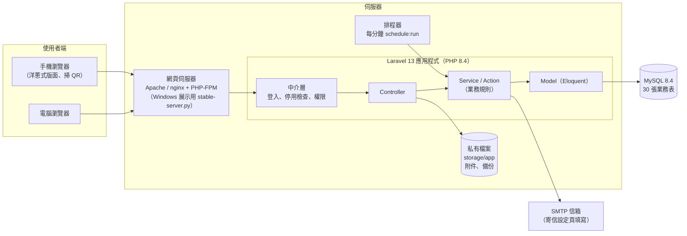
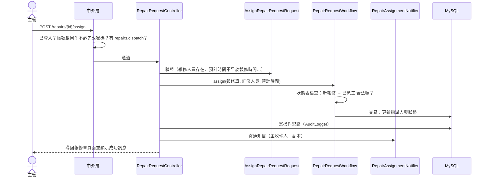
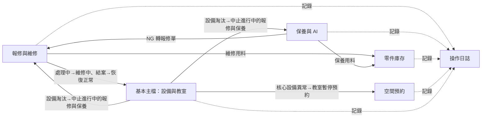
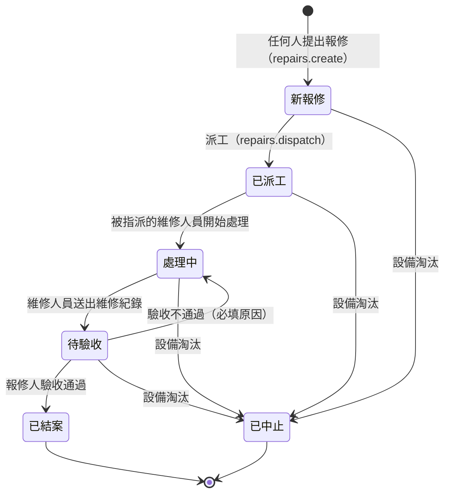
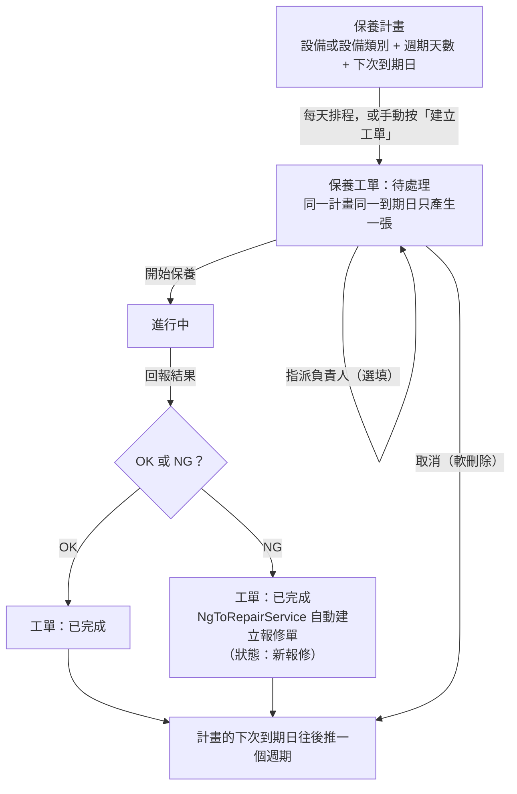
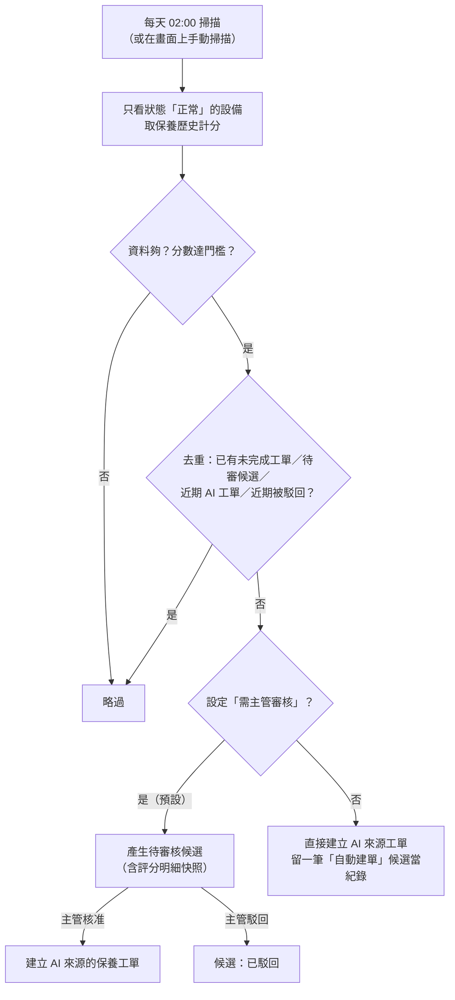
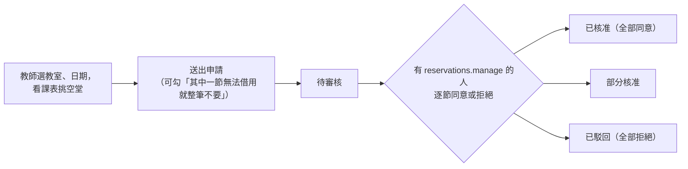
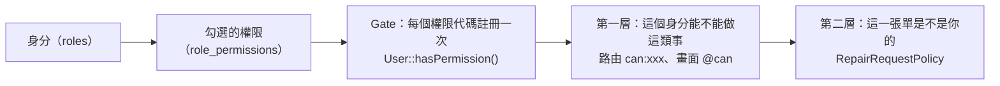
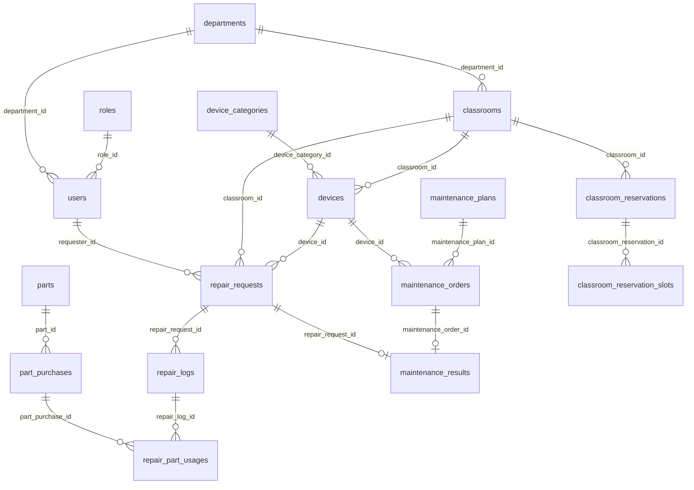

# 系統架構

> 學校設備維保電子化系統的整體設計：系統長什麼樣子、程式怎麼分層、各功能模組怎麼分工、資料怎麼流動、怎麼部署與驗證。
> 內容依 2026-11-23 的程式、路由與設定整理（`integrate/all` 分支）。資料表欄位的完整說明在《資料字典》，命名規則在《資料庫命名規範與資料字典》。

| 章節 | 內容 |
|---|---|
| 1 | 系統概述 |
| 2 | 整體架構圖 |
| 3 | 技術選型 |
| 4 | 程式分層：一個請求怎麼走 |
| 5 | 目錄結構 |
| 6 | 功能模組 |
| 7 | 核心流程（報修、設備狀態、保養、AI 預防保養、零件庫存、空間預約） |
| 8 | 權限與安全 |
| 9 | 資料架構 |
| 10 | 共用機制 |
| 11 | 排程與指令 |
| 12 | 部署與維運 |
| 13 | 品質保證 |
| 14 | 已知限制與待確認 |

## 1. 系統概述

**一句話**：用網頁把學校設備的「自助排除、報修、派工、維修、驗收、定期保養、零件庫存、教室預約」串成一條線，每個動作都留下紀錄。

**使用者**（系統內建五個身分，可在「身分主檔」調整權限）：

| 身分 | 主要做什麼 |
|---|---|
| 系統管理員（admin） | 全部權限，另有寄信設定、資料備份 |
| 設備管理員（it_manager，資訊組主管） | 主檔管理、派工、保養與 AI 預防保養、零件庫存、空間預約審核、查看操作紀錄 |
| 維修人員（technician） | 處理被指派的報修單、填維修紀錄、回報保養結果 |
| 教師（teacher） | 提出報修、驗收自己報修的案件、申請教室 |
| 主管（executive） | 提出報修、派工、看全部案件、驗收、查看保養資料 |

**規模**（2026-11-23）：

| 項目 | 數量 |
|---|---|
| 資料表 | 30 張業務表（另有 Laravel 內建 8 張）、300 個欄位、51 條外鍵 |
| 網址（路由） | 177 條（GET 100、POST 41、PUT 16、PATCH 10、DELETE 10） |
| 程式 | 34 個 Controller 檔、29 個 Model、28 個 Service 檔（含介面與子資料夾）、1 個 Action、127 個畫面檔、72 支 migration |
| 測試 | 926 個自動測試、13 個瀏覽器端到端情境 |

## 2. 整體架構圖



重點：

- **單體式（monolith）**：一個 Laravel 專案同時負責畫面與資料，沒有前後端分離；畫面由伺服器用 Blade 產生，只有少數 JSON 接口（掃碼查設備、課表、預覽匯出）。
- **前端不需要建置**：Bootstrap、圖示、Chart.js、掃碼函式庫都放在 `public/vendor`，不連外部網站，沒有網路也能用。
- **私有檔案**：照片、發票、備份都放在網站根目錄之外，只能經網站依權限下載。

## 3. 技術選型

| 層 | 技術 | 用途 |
|---|---|---|
| 語言與框架 | PHP 8.4、Laravel 13 | 後端、路由、驗證、權限（Gate）、排程 |
| 資料庫 | MySQL 8.4（InnoDB、utf8mb4） | 正式與開發資料庫 |
| 畫面 | Blade 樣板、Bootstrap 5.3、Bootstrap Icons、Chart.js 4 | 頁面、版面、圖表；全站風格「校園溫和」在 `public/css/theme-b.css` |
| 掃描 | barcode-detector、zxing（WebAssembly） | 手機相機掃設備 QR／條碼；沒有 https 時改用拍照掃描 |
| QR Code | simplesoftwareio/simple-qrcode | 產生設備 QR Code 與貼紙 |
| 匯出 | maatwebsite/excel 4、barryvdh/laravel-dompdf（Noto Sans TC 字型） | Excel 與 PDF 匯出；匯入 Excel／CSV |
| 測試 | PHPUnit 12（SQLite 記憶體）、Playwright（Python，真的 Chrome） | 功能測試、端到端測試 |
| 品質 | Larastan（靜態分析）、Pint（程式風格）、composer audit | 讀程式找潛在錯誤、套件弱點 |
| 自動化 | GitHub Actions | 每次 push 跑四組檢查（見第 13 章） |

> 專案裡有 `vite`、`tailwindcss` 的設定檔，但畫面沒有使用（沒有 `@vite`、沒有建置產物），目前不需要 `npm install`。

## 4. 程式分層：一個請求怎麼走

以「主管按下派工」為例：



每一層的分工：

| 層 | 位置 | 負責 | 不該做 |
|---|---|---|---|
| 路由 | `routes/web.php` | 網址對到哪個 Controller、要有什麼權限（`can:xxx`） | 寫邏輯 |
| 中介層 | `app/Http/Middleware`、`bootstrap/app.php` | 登入、帳號啟用、強制改密碼、語言、安全標頭、壓縮 | 業務規則 |
| Controller | `app/Http/Controllers` | 接請求、驗證、檢查「這一筆能不能動」、呼叫 Service、回畫面或轉址 | 自己改狀態、自己算庫存 |
| Form Request | `app/Http/Requests` | 比較複雜的表單驗證（維修紀錄、保養結果、派工等 12 支） | — |
| Policy | `app/Policies/RepairRequestPolicy` | 「這一張報修單是不是你的」 | — |
| Service／Action | `app/Services`、`app/Actions` | **業務規則的唯一入口**（見下方） | 直接處理畫面 |
| Model | `app/Models` | 資料表對應、關聯、查詢範圍（scope） | — |
| 資料庫 | `database/migrations` | 資料結構、外鍵、索引 | — |

**「唯一入口」原則**：這幾件事全專案只有一個地方可以做，其他地方一律呼叫它，規則才不會散落、也不會前後不一致：

| 事情 | 唯一入口 |
|---|---|
| 報修單狀態怎麼變 | `RepairRequestWorkflow`（狀態轉換表 `TRANSITIONS`） |
| 設備狀態與教室異常旗標 | `DeviceStatusService`（和 `DeviceStatusSync`） |
| 零件庫存進出與成本 | `PartStockService`（先進先出） |
| 空間預約審核與時段衝突 | `ReservationReviewService` |
| 操作日誌 | `AuditLogger` |
| 附件上傳 | `AttachmentUploader` |
| 保養 NG 轉報修 | `NgToRepairService` → `CreateRepairRequestFromMaintenanceNg` |
| 權限清單 | `PermissionCatalog` |

## 5. 目錄結構

| 路徑 | 內容 |
|---|---|
| `app/Http/Controllers` | 34 個 Controller（含 `Auth/` 登入與忘記密碼） |
| `app/Http/Middleware` | 8 個中介層 |
| `app/Http/Requests` | 12 支表單驗證 |
| `app/Models` | 29 個 Model（每張資料表一個） |
| `app/Services` | 業務規則：報修流程、設備狀態、庫存、預約、備份…；子資料夾 `AI/`（預測）、`Import/`（批次匯入）、`Timetable/`（課表來源） |
| `app/Actions` | 跨模組的單一動作（保養 NG 建報修單） |
| `app/Policies` | 報修單歸屬權限 |
| `app/Enums` | 報修單狀態列舉 |
| `app/Exports` | Excel／PDF 匯出（成本分析、零件、表格） |
| `app/Support` | 小工具：權限清單、選單、附件限制、匯出回應、備份連結… |
| `app/Console/Commands` | 自訂指令（見第 11 章） |
| `routes/web.php`、`routes/console.php` | 網址地圖、排程 |
| `resources/views` | 127 個 Blade 畫面，依模組分資料夾；`layouts/` 是共用版面與洋蔥式元件 |
| `lang/zh_TW`、`lang/en` | 中英文畫面文字（預設中文，語言切換選單預設隱藏） |
| `public/vendor`、`public/css/theme-b.css` | 本機放一份的前端函式庫與全站風格 |
| `database/migrations`、`seeders`、`factories` | 資料結構、示範資料、測試用假資料 |
| `config/timetable.php` | 節次時間與示範課表 |
| `tests/Feature`、`tests/Unit`、`tests/e2e` | 自動測試與瀏覽器測試 |
| `tools/stable-server.py` | Windows 本機穩定伺服器（展示用） |
| `docs/` | 文件（本文件、資料字典、部署清單…） |

## 6. 功能模組

| 模組 | 主要網址 | Controller | Service／Action | 資料表 | 權限 |
|---|---|---|---|---|---|
| **帳號與權限** | `/users`、`/roles`、`/departments`、`/majors`、`/login`、`/forgot-password` | User、Role、Department、Major、Auth/Login、Auth/PasswordRecovery | `UserImporter` | `users`、`roles`、`role_permissions`、`departments`、`majors` | `users.manage`、`roles.manage`、`departments.manage`、`majors.manage` |
| **基本主檔** | `/classrooms`、`/device-categories`、`/devices`、`/d/{設備編號}`、`/import/{devices\|users}` | Classroom、DeviceCategory、Device、DeviceEntry、BulkImport | `DeviceStatusService`、`DeviceImporter`、`RetiredDeviceCleanup` | `classrooms`、`device_categories`、`devices`、`import_batches` | `classrooms.manage`、`device-categories.manage`、`devices.manage` |
| **報修與維修** | `/repairs`、`/repairs/{id}/repair-logs`、`/knowledge-base`、`/attachments/{id}` | RepairRequest、RepairLog、KnowledgeBase、Attachment | `RepairRequestWorkflow`、`DeviceStatusSync`、`RepairAssignmentNotifier`、`AttachmentUploader`、`ClassroomRepairNotices` | `repair_requests`、`repair_logs`、`repair_part_usages`、`knowledge_base`、`attachments` | `repairs.create`／`dispatch`／`process`／`accept`、`knowledge-base.manage`；另有 `RepairRequestPolicy` |
| **保養與 AI 預防保養** | `/maintenance-items`、`/maintenance-plans`、`/maintenance-orders`、`/device-profile`、`/ai-maintenance/*` | MaintenanceItem、MaintenancePlan、MaintenanceOrder、MaintenanceResult、DeviceProfile、MaintenanceCompletionRate、PreventiveCandidate、AiSetting | `DueMaintenanceOrderGenerator`、`NgToRepairService`、`AI/*`、`MaintenanceCompletionRateService` | `maintenance_items`、`maintenance_plans`、`maintenance_plan_items`、`maintenance_orders`、`maintenance_results`、`maintenance_part_usages`、`ai_settings`、`preventive_candidates` | `maintenance.view`／`manage`／`report`、`ai-maintenance.manage` |
| **零件庫存與成本** | `/parts`、`/parts/{id}/purchases`、`/parts/{id}/scraps`、`/repair-cost-analysis` | Part、PartPurchase、PartScrap、RepairCostAnalysis | `PartStockService`、`RepairCostAnalysisService` | `parts`、`part_purchases`、`part_scraps`、`part_scrap_batches`（用料明細在維修與保養的明細表） | `parts.manage` |
| **空間預約** | `/reservations`、`/schedule`（免登入查課表） | ClassroomReservation、Timetable | `ReservationReviewService`、`Timetable/*` | `classroom_reservations`、`classroom_reservation_slots` | 申請：所有登入者；審核：`reservations.manage` |
| **主控台與稽核** | `/dashboard`、`/audit-logs` | Dashboard、AuditLog | `MasterCharts`、`AuditLogger` | `audit_logs` | 主控台：所有登入者（依權限顯示）；操作紀錄：`audit-logs.view` |
| **系統管理** | `/mail-settings`、`/backups` | MailSetting、Backup | `DatabaseBackup` | `mail_settings` | `mail-settings.manage`、`backups.manage`（預設只有系統管理員） |

模組之間的接口（誰呼叫誰）：



## 7. 核心流程

### 7.1 報修主流程



| 步驟 | 誰能做 | 規則 |
|---|---|---|
| 提出報修 | 有 `repairs.create` 的人 | 可掃設備 QR 帶入設備；附件最多 5 個、合計 5 MB（jpg、png、webp、pdf、mp4、mov、webm） |
| 派工、重新指派 | 有 `repairs.dispatch` 的人 | 預計處理時間不能早於報修送出時間；派工後寄通知信給維修人員，副本給有 `repairs.notice_cc` 的人；重新指派不改變狀態 |
| 開始處理 | 被指派的維修人員本人 | 只能用在「已派工」的案件 |
| 填維修紀錄 | 被指派的維修人員本人 | 同一個資料庫交易內：存維修紀錄、依先進先出扣零件庫存、推進到「待驗收」；開始時間不能早於報修時間、不能是未來 |
| 驗收通過／退回 | 報修人本人（沒有報修人的案件由有 `repairs.accept` 的人） | 退回一律回「處理中」，原本的維修紀錄保留，維修人員再填新的一筆 |
| 已結案、已中止 | — | 終點，不能再改 |

狀態轉換規則只寫在 `RepairRequestWorkflow` 的轉換表，Controller 不直接改狀態。

### 7.2 設備狀態連動

設備狀態有四種：`normal` 正常、`repairing` 維修中、`retired` 已淘汰、`disabled` 停用。

| 事件 | 結果 |
|---|---|
| 報修單進入「處理中」 | 這台設備自動變「維修中」（已淘汰、停用的不覆蓋） |
| 報修單「已結案」 | 沒有其他未結案報修單、而且設備目前是「維修中」，才自動恢復「正常」 |
| 核心設備（`is_core`）狀態變成維修中、已淘汰或停用 | 所在教室 `reservation_status` 變 `abnormal`，教室暫停預約；排除後自動恢復 |
| 設備改成「已淘汰」 | 同一個交易內，`RetiredDeviceCleanup` 把它進行中的報修單中止、保養工單中止、保養計畫停用、等待審核的 AI 候選駁回、未轉報修的 NG 標成不需轉報修；已結案與歷史紀錄原樣保留，之後唯讀 |

「異常設備」的定義只有一份（`DeviceStatusService::PROBLEM_STATUSES`：維修中、已淘汰、停用），教室主檔、設備主檔與主控台都用它。

### 7.3 定期保養



- 保養用料與維修用料同樣走 `PartStockService`，記下當時單價。
- 保養執行時間不能早於工單建立時間、不能是未來。
- NG 轉報修只呼叫報修模組的 `CreateRepairRequestFromMaintenanceNg`，不複製寫入邏輯；報修單帶有 `maintenance_result:{id}` 標記，兩邊可互相追溯。

### 7.4 AI 預防保養

這是**規則式、可解釋**的風險評分，不是機器學習：

```
風險分數（0～1）= 0.5 × 最近 N 筆保養的 NG 比例
               + 0.3 × min(結尾連續 NG 次數, 3) ÷ 3
               + 0.2 × 保養逾期程度（距上次保養 ≤45 天為 0，≥90 天為 1，中間線性）
```



權重、門檻、去重天數等參數存在 `ai_settings`，可在畫面調整；演算法換掉時，寫一個新類別實作 `PredictionServiceInterface` 並改 `AppServiceProvider` 的綁定即可。

### 7.5 零件庫存與先進先出成本

- **進貨**：每筆採購是一個批次（`part_purchases`），`remaining_quantity` 是這一批還沒用掉的數量。
- **用料與報廢**：從「日期不晚於它、最早、還有剩」的批次開始扣；一次跨兩批就拆成兩列，每列記下那一批的單價（成本快照）。
- **目前庫存** `parts.current_stock` 等於各批次剩餘數量加總，是為了列表與扣料檢查保留的快取值，只能由 `PartStockService` 更新。
- **依日期重算**：補登比較早的用料或報廢時，該零件所有用料與報廢會依發生時間重新扣一次；如果某一筆在它的日期當時庫存不夠，整個動作被擋下、什麼都不改。
- **鎖定**：扣庫存時鎖住零件那一列（`lockForUpdate`），兩個人同時扣不會算錯。
- 採購與報廢送出後就定案：只能新增與查看，不能修改、刪除。

### 7.6 空間預約



- 同一間教室、同一個時間只能有一個「已核准」的時段；一節被同意後，重疊的其他待審時段會自動拒絕。
- 暫停預約的教室（核心設備異常）仍可查課表，但不能送出申請、也不能核准。
- 時間過了還沒審核的申請維持待審核，之後仍可補審；被拒絕與整筆時段都過期的申請，每月第二、四個週日跨週一零點自動清除。
- 課表資料來自 `TimetableProvider` 介面，目前實作是 `LocalTimetableProvider`（讀 `config/timetable.php` 的示範課表）；日後接學校課表系統只要新增一個實作並改設定。

## 8. 權限與安全

### 8.1 兩層權限



- 權限清單只有一份：`app/Support/PermissionCatalog.php`，分 master、repair、maintenance、knowledge、reservation、inventory 六組，共 23 個權限；系統管理員永遠全開。
- 內建身分的預設權限：

| 權限群 | 設備管理員 | 維修人員 | 教師 | 主管 |
|---|---|---|---|---|
| 主檔管理（教室、科系、類別、設備） | 有 | — | — | — |
| 查看操作紀錄 | 有 | — | — | — |
| 提出報修 | 有 | 有 | 有 | 有 |
| 派工 | 有 | — | — | 有 |
| 處理維修、可被指派 | — | 有 | — | — |
| 驗收 | — | — | 有 | 有 |
| 保養：查看／管理／回報／AI | 全有 | 查看、回報 | — | 查看 |
| 零件庫存、空間預約審核、知識庫管理 | 有 | — | — | — |

- 用戶主檔、身分主檔、單位主檔、資料備份、寄信設定預設只有系統管理員（可在身分主檔勾選給別人）。
- 報修單的資料範圍（`RepairRequestPolicy`）：能派工的人與管理員看全部；其他人只看自己報修或被指派的；只有被指派的維修人員能開始處理與填維修紀錄；只有報修人能驗收或退回。
- 未上架的知識庫文章只有有 `knowledge-base.manage` 的人看得到；附件下載會先檢查「能不能看所屬報修單」。

### 8.2 帳號與傳輸安全

| 項目 | 做法 |
|---|---|
| 登入保護 | 同一「帳號＋IP」5 分鐘內失敗 5 次暫時鎖定；同一 IP 不論換幾個帳號最多 20 次 |
| 停用帳號 | 每個請求都檢查 `is_active`，連「記住我」自動登入的也會被強制登出 |
| 忘記密碼 | 寄臨時密碼到註冊 Email（只存雜湊、30 分鐘有效、用過作廢；同 IP 每分鐘最多 5 次）；用臨時密碼登入後，設定新密碼前哪裡都不能去 |
| 批次匯入的帳號 | 一律標記「第一次登入一定要先設定新密碼」 |
| 瀏覽器安全標頭 | 禁止被嵌入別的網站、禁止猜檔案類型、限制來源網址外洩、只有本站能用相機；https 時加 HSTS |
| 輸入與輸出 | 表單驗證；網址篩選條件被改成陣列時忽略（避免整頁 500）；Excel 匯出的 `= + - @` 開頭文字不當公式執行 |
| 檔案 | 附件、備份放私有磁碟，不能用網址直接開 |
| 密碼與機密 | 登入密碼雜湊儲存；寄信密碼加密存放，畫面與操作紀錄都不顯示 |

## 9. 資料架構

完整欄位見《資料字典》，這裡只講設計原則。資料表分七個模組：



（這是主要骨幹；全部 51 條外鍵見《資料字典》第 4 節與各模組關聯圖。）

設計原則：

| 原則 | 做法 |
|---|---|
| 命名一致 | 主鍵一律 `id`；指向其他表叫 `<表單數>_id`；指向人只有 `requester_id`、`manager_id`、`assigned_to`、`*_by` 四種寫法；測試會自動檢查 |
| 正規化 | 一個欄位一個值（權限拆成 `role_permissions`）；能由別的欄位算出來的不另存（例外都寫在文件裡並說明理由） |
| 歷史不消失 | 用戶、教室、設備、報修單、保養工單用**軟刪除**；指向人與主檔的外鍵多半「設為空白」而不是連帶刪除 |
| 當時的快照 | 零件單價（先進先出批次）、操作日誌說明文字、AI 評分明細、報修地點（報修當時的教室）都存「當時」的值，之後主檔改了也不影響歷史 |
| 多型關聯 | 附件與操作日誌用 `<名詞>_type`＋`<名詞>_id` 指向任何資料，不加外鍵 |
| 快取欄位只有一個入口 | `parts.current_stock`、`classrooms.reservation_status`、`maintenance_plans.next_due_date` 都是推得的值，只能由對應的 Service 更新 |
| 資料庫與測試分開 | 測試用記憶體 SQLite，正式與開發用 MySQL；CI 另用真的 MySQL 從零跑一次所有 migration |

## 10. 共用機制

| 機制 | 說明 | 位置 |
|---|---|---|
| 操作日誌 | 新增、修改、刪除、派工、狀態變更、登入、登出、登入失敗都記錄；描述是寫入當下的快照 | `AuditLogger`、`audit_logs` |
| 附件 | 報修、維修紀錄、採購發票的照片、影片、PDF；存私有磁碟、依權限下載 | `AttachmentUploader`、`AttachmentController` |
| 匯出與預覽 | 清單可匯出 Excel；**先在視窗預覽、確認後才下載**（預覽不寫稽核紀錄、下載才寫）；零件與成本分析另有 PDF | `TableExportResponse`、`resources/views/exports` |
| 批次匯入 | 設備、用戶：下載範本 → 上傳預覽（錯誤列標出）→ 確認寫入 → 可整批復原 | `Services/Import`、`import_batches` |
| 通知鈴鐺 | 依權限顯示待辦：待派工、待驗收、指派給我、待審核預約、7 天內到期與未指派的保養工單；每一項點下去帶好篩選條件 | `AppServiceProvider::notificationItemsFor` |
| 主控台 | 數字卡片與圖表，點擊跳到已篩選好的清單；數字只統計這位用戶看得到的資料 | `DashboardController`、`MasterCharts` |
| 手機洋蔥式版面 | 手機寬度（< 768px）上清單變卡片、篩選收成按鈕、長表單分段；桌面版不變 | `layouts/partials/*-onion`、`form-stepper`、`theme-b.css` |
| 站內對話框 | 網址帶 `?modal=1` 的表單在對話框內開啟，送出成功後通知外層頁面跳轉 | `EmbeddedModal` |
| 寄信 | 預設寫進 `storage/logs`；管理員在「寄信設定」填 SMTP 帳號後，全站改用那組設定 | `MailSetting::applyEnabledToConfig` |
| 備份與還原 | 整個資料庫＋附件壓成一個 zip；每月 1 號凌晨 0 點自動備份，保留天數可調（預設 180 天）；還原前先自動備份一次 | `DatabaseBackup`、`/backups` |
| 多語系 | 預設繁體中文，英文翻譯齊備但切換選單預設隱藏 | `lang/`、`SetLocale` |
| 防誤用 | 已結案、已完成、已淘汰的資料唯讀；時間欄位有先後與合理範圍檢查 | 各 Request 與 Service |

## 11. 排程與指令

排程定義在 `routes/console.php`，**伺服器必須每分鐘執行一次 `php artisan schedule:run`**，否則下面全部不會自動跑。

| 排程名稱 | 頻率 | 做什麼 |
|---|---|---|
| `maintenance:generate-due-orders` | 每天 | 為到期且啟用中的保養計畫產生保養工單 |
| `ai:scan-preventive` | 每天 02:00 | 掃描設備風險，產生 AI 預防保養候選 |
| `reservations:cleanup` | 每月第二、四個週日跨週一 0:00 | 清除已拒絕與時段已過還沒審核的預約申請 |
| `backup:run` | 每月 1 號 0:00 | 備份資料庫與附件，並刪除超過保留天數的舊備份 |
| `schedule:heartbeat` | 每分鐘 | 記錄「排程正在跑」，`deploy:check` 靠它判斷有沒有設定 cron |
| `imports:prune` | 每小時 | 清掉超過 2 小時沒確認的批次匯入預覽暫存檔 |

手動指令：

| 指令 | 用途 |
|---|---|
| `php artisan deploy:check` | 部署前檢查（除錯模式、https、寄信、排程、資料夾權限…），有錯誤時結束代碼為 1 |
| `php artisan docs:schema`（`--check`） | 重新產生／檢查兩份資料庫文件 |
| `php artisan parts:rebuild-fifo`（`--dry-run`） | 依日期重算零件的先進先出批次 |
| `php artisan ai:device-features {設備編號}` | 查看某台設備的 AI 特徵（除錯用） |
| `php artisan migrate:fresh --seed` | 重建資料庫並寫入示範資料（**會清空資料**，只在本機用） |

## 12. 部署與維運

**執行環境**：PHP 8.4（含 `pdo_mysql`、`zip`、`gd`、`mbstring`、`intl`）、Composer 2、MySQL 8.4。

| 項目 | 說明 |
|---|---|
| 開發 | `php artisan migrate:fresh --seed` 建庫；Windows 展示請用 `python tools/stable-server.py`（PHP 內建伺服器在 Windows 會隨機截斷較大的回應，造成跑版與按鈕沒反應） |
| 正式 | Apache 或 nginx + PHP-FPM；`.env` 設 `APP_ENV=production`、`APP_DEBUG=false`、`APP_URL=https://…`、`SESSION_SECURE_COOKIE=true`、`MAIL_MAILER=smtp`；時區 `Asia/Taipei` |
| https | 手機相機即時掃 QR 需要 https（或 localhost）；沒有 https 時掃描視窗自動改成「拍照掃描」 |
| 排程 | Windows 用工作排程器、Linux 用 cron，每分鐘執行 `schedule:run` |
| PHP 設定 | `post_max_size` 至少 8M、`upload_max_filesize` 至少 5M；網站帳號要能寫入 `storage/`、`bootstrap/cache/` |
| 更新程式 | 先備份 → `git pull` → `composer install --no-dev --optimize-autoloader` → `php artisan migrate --force` → `php artisan view:clear` → `php artisan deploy:check` |
| 儲存位置 | `storage/app/private`（附件、匯入暫存）、`storage/app/backups`（備份）、`storage/logs`（紀錄與未真正寄出的信） |
| 健康檢查 | `/up`（Laravel 內建，監控用） |

細節見《部署檢查清單》。

## 13. 品質保證

| 項目 | 做法 |
|---|---|
| 自動測試 | 926 個 PHPUnit 測試（`php artisan test`，用記憶體 SQLite），涵蓋流程、權限、驗證規則、資料庫命名規則與正規化、文件是否最新 |
| 瀏覽器端到端 | 13 個情境，用真的 Chrome 走主要流程（登入權限、報修全流程、空間預約、保養、批次匯入、QR、寄信設定、手機版面、安全標頭）：`python tests/e2e/run.py` |
| 靜態分析 | Larastan（`composer analyse`）：舊問題記在基線檔，新程式不能再增加 |
| 程式風格 | Pint：CI 只強制「這次新增的檔案」要符合 |
| 套件安全 | `composer audit` |
| 文件同步 | `php artisan docs:schema --check`：資料庫改了卻沒更新文件，測試與 CI 會失敗 |

**GitHub Actions**（每次 push 與 Pull Request 自動跑，`.github/workflows/tests.yml`）：

| 任務 | 內容 |
|---|---|
| 自動測試（PHPUnit） | 完整測試，不需要資料庫 |
| MySQL 資料庫檢查 | 用真的 MySQL 8.4 從零跑所有 migration 與示範資料、檢查資料字典是不是最新、`deploy:check` 能執行 |
| 靜態分析 | `composer audit`、Pint（新檔）、Larastan |
| 瀏覽器端到端測試 | 前面通過才跑 |

## 14. 已知限制與待確認

| 項目 | 說明 |
|---|---|
| 課表是示範資料 | 目前的課表來自 `config/timetable.php`；介面已預留（`TimetableProvider`），尚未接學校真正的課表系統 |
| 寄信預設不會真的寄 | `MAIL_MAILER=log` 只寫進紀錄；要由管理員在「寄信設定」頁填 SMTP 才會寄出 |
| 沒有使用佇列 | 寄信是即時寄出；`jobs` 等佇列資料表是 Laravel 預設建立、目前沒有使用 |
| 報修狀態與規格書不同 | 規格書的 `REOPEN`、`REJECTED` 未實作；驗收不通過退回「處理中」；另新增「已中止」（設備淘汰） |
| 設備狀態 | 規格書列了 idle、scrapped，目前是 normal、repairing、retired、disabled 四種；完整列舉屬待確認事項 |
| AI 預防保養規則 | 權重、門檻、去重天數是工程實作決定，可在畫面調整，仍待全組確認 |
| 保養完成率公式 | 分母＝排定日在期間內的工單（設備淘汰中止的不算）、分子＝已完成；待全組確認 |
| Windows 展示 | 請用 `tools/stable-server.py`，不要用 `php artisan serve` |

其他待確認事項見 `docs/跨組待確認事項.md` 與 `docs/待確認/`。
