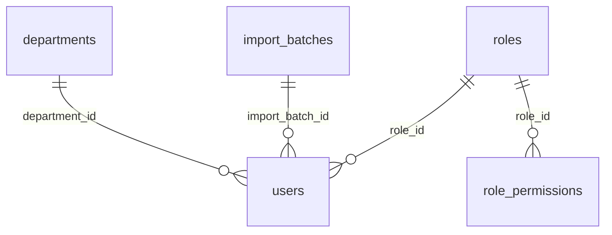
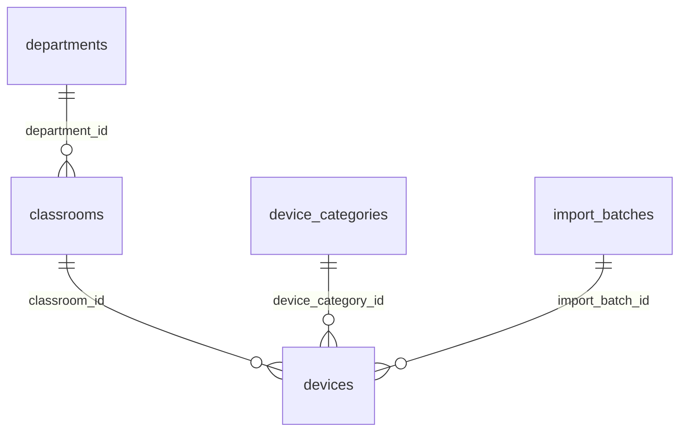
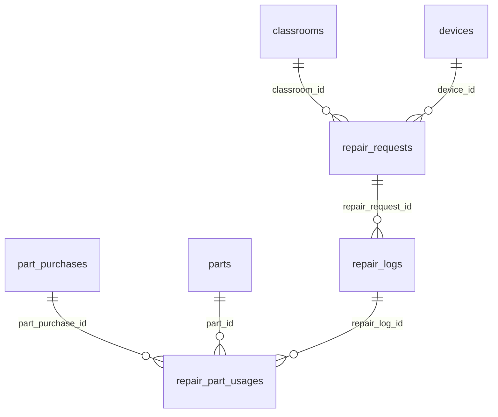
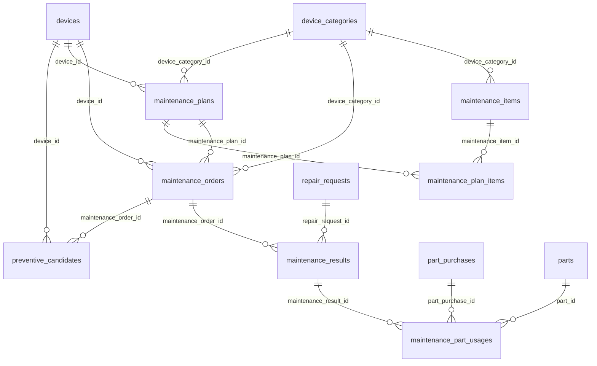
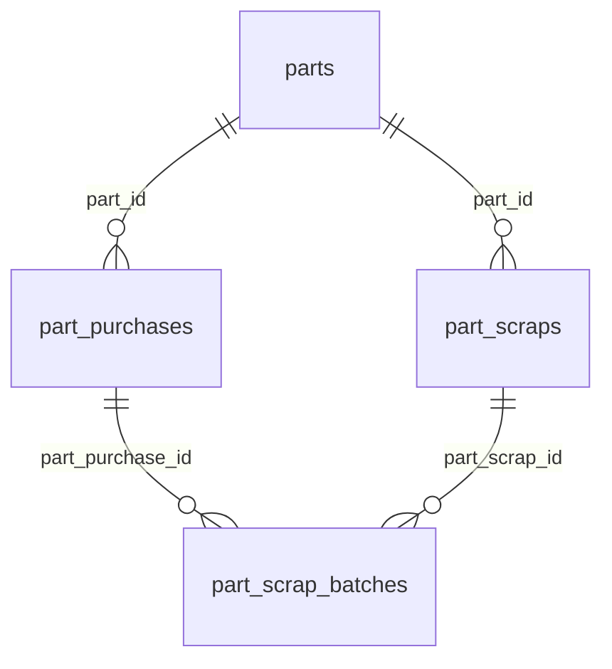
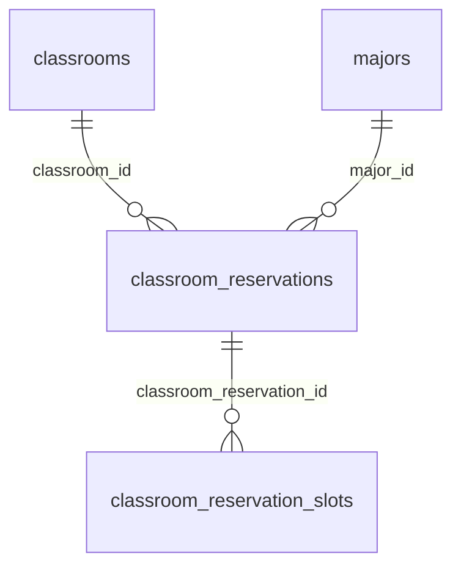

# 資料字典

> 每一張資料表的**實際**欄位型態、長度、是否可空白、預設值、主鍵／唯一／外鍵（含刪除規則）與索引。
> 內容從 MySQL 的 `information_schema` **自動產生**（`php artisan docs:schema`，需連到 MySQL）；資料庫異動請改 migration 再重新產生。
> 文件過期時，GitHub 上的「MySQL 資料庫檢查」會失敗（`php artisan docs:schema --check`）。
> 命名規則、正規化結論與和規格書的差異，見同資料夾的《資料庫命名規範與資料字典》；系統整體設計見《系統架構》。

## 1. 概況

| 項目 | 內容 |
|---|---|
| 資料庫 | MySQL 8.4（InnoDB，定序 utf8mb4_unicode_ci） |
| 業務資料表 | 30 張（另有 Laravel 內建 8 張，見附錄） |
| 欄位總數 | 300（業務資料表） |
| 外鍵約束 | 51 條（見第 4 節） |
| 主鍵 | 一律是 `id`（自動編號的大整數） |
| 時間 | 系統時區 Asia/Taipei；`created_at`／`updated_at` 由 Laravel 自動維護 |
| 軟刪除 | 有 `deleted_at` 的資料表（用戶、教室、設備、報修單、保養工單）刪除只是填上時間，資料保留供履歷追溯 |

### 怎麼讀欄位表

| 欄位 | 意思 |
|---|---|
| 型態 | MySQL 實際型態。`bigint unsigned`＝大整數（不能是負數）；`varchar(255)`＝最長 255 字的文字；`tinyint(1)`＝布林（0／1）；`timestamp`＝日期時間；`text`／`json` 見字面 |
| 允許空白 | Y＝可以沒有值（NULL）；空白＝一定要有值 |
| 預設值 | 新增資料沒有指定時，資料庫自動填的值；空白＝沒有預設值 |
| 約束 | PK 主鍵；UNI 不可重複；FK 外鍵（指向哪張表、被指的那筆刪掉時怎麼辦）；組合唯一＝幾個欄位合起來不可重複 |
| 刪除規則 | **連帶刪除**＝上層刪了，這筆跟著刪；**設為空白**＝上層刪了，這個欄位變空白、這筆保留；**禁止刪除**＝還有資料指向它時，上層不能刪 |

## 2. 資料表分組總覽

| 模組 | 資料表 | 中文名稱 | 用途 |
|---|---|---|---|
| **帳號與權限** | `roles` | 角色主檔（身分） | 身分。內建五個：admin 系統管理員、it_manager 設備管理員、technician 維修人員、teacher 教師、executive 主管；每個用戶只有一個身分。 |
|  | `role_permissions` | 身分權限 | 每個身分勾選了哪些權限，一列一個權限代碼（權限清單在 PermissionCatalog）。 |
|  | `users` | 使用者主檔 | 系統帳號。停用或軟刪除後不能登入，但報修、保養等紀錄仍保留；含「忘記密碼」臨時密碼流程用的欄位。 |
|  | `departments` | 單位主檔 | 單位（部門）清單，用戶與教室的「所屬單位」下拉選單來源。 |
| **基本主檔** | `majors` | 科系主檔 | 科系，以及各科系的年級數與每年級班數；空間預約申請班級的下拉選單來源。 |
|  | `classrooms` | 教室主檔 | 教室，含校區、樓層與管理人；有核心設備異常時 reservation_status 會變成 abnormal，教室暫停預約。 |
|  | `device_categories` | 設備類別 | 設備類別（投影機、電腦…）；設備、保養項目、保養計畫與保養工單都依類別分類。 |
|  | `devices` | 設備主檔 | 設備。device_code（管制編號）就是 QR Code 的內容；有狀態、是否核心設備與保固日；停用以軟刪除處理，履歷保留。 |
| **報修與維修** | `repair_requests` | 報修單 | 報修單，也是報修主流程的狀態機：新報修 → 已派工 → 處理中 → 待驗收 → 已結案（驗收不通過退回處理中；設備淘汰時進行中的單會變已中止）。 |
|  | `repair_logs` | 維修紀錄 | 維修人員每次處理的紀錄（原因、處置、起訖時間、工時）；驗收退回後會再填新的一筆，舊的不修改。 |
|  | `repair_part_usages` | 維修零件使用明細 | 維修用掉的零件、數量與「扣料當下那一批」的單價（先進先出成本快照）。 |
|  | `knowledge_base` | 自助知識庫文章 | 自助排除知識庫文章（常見故障與處理步驟），報修前先查；有上架旗標與查看次數。 |
| **保養與 AI 預防保養** | `maintenance_items` | 保養項目 | 保養項目（要檢查什麼），可指定適用的設備類別。 |
|  | `maintenance_plans` | 保養計畫 | 保養計畫：針對一台設備或一類設備，設定保養週期與下次到期日；排程依它自動產生工單。 |
|  | `maintenance_plan_items` | 保養計畫明細 | 保養計畫包含哪些保養項目（多對多的中間表）。 |
|  | `maintenance_orders` | 保養工單 | 保養工單，來源是定期計畫或 AI 預防保養；狀態：待處理 → 進行中 → 已完成（設備淘汰時未完成的會變已中止）。取消用軟刪除。 |
|  | `maintenance_results` | 保養結果 | 保養結果（OK／NG），與工單一對一；NG 可以轉成一張報修單。 |
|  | `maintenance_part_usages` | 保養零件使用明細 | 保養用掉的零件與當時單價，結構與維修用料相同。 |
|  | `ai_settings` | AI 預防保養參數 | AI 預防保養的參數（「參數名稱＋參數值」），例如門檻、去重天數、是否需主管審核。 |
|  | `preventive_candidates` | 預防保養候選 | AI 掃描出的預防保養候選（含評分明細快照）；主管核准後才建立 AI 來源的保養工單。 |
| **零件庫存** | `parts` | 零件庫存 | 零件主檔：編號、單位、安全庫存與目前庫存（目前庫存是各批次剩餘數量的加總，只能由庫存服務更新）。 |
|  | `part_purchases` | 零件採購紀錄 | 零件進貨批次，每一筆是一個批次；用料與報廢依先進先出從最早、還有剩的批次扣。 |
|  | `part_scraps` | 零件報廢紀錄 | 零件報廢單（損壞、過期、遺失）。 |
|  | `part_scrap_batches` | 零件報廢扣用批次 | 報廢扣了哪幾個進貨批次與當時單價（取消報廢時依它加回庫存）。 |
| **空間預約** | `classroom_reservations` | 教室預約申請 | 空間預約申請（誰、哪間教室、哪個班級、用途）；整筆申請的狀態由底下各時段的審核結果決定。 |
|  | `classroom_reservation_slots` | 教室預約時段明細 | 預約申請的每一個時段（日期與起訖時間），可以逐節同意或拒絕；使用時間只記在這裡。 |
| **系統共用** | `attachments` | 附件資料 | 附件（報修與維修照片、採購發票），用多型關聯掛在各種資料底下；檔案存在私有磁碟，只能透過網站依權限下載。 |
|  | `audit_logs` | 操作日誌 | 操作日誌：誰、何時、對哪筆資料做了什麼；說明文字是寫入當下的快照。 |
|  | `import_batches` | 批次匯入紀錄 | 批次匯入（設備、用戶）的紀錄；設備與用戶以 import_batch_id 指回來，匯錯時可以整批復原。 |
|  | `mail_settings` | 寄信設定 | 寄信用的 SMTP 設定，整張表只有一筆；密碼加密存放。 |

## 3. 各模組的資料字典

### 3.1 帳號與權限

誰可以登入、屬於哪個單位、能做哪些事（身分像 Discord 身分組，勾選要開放的權限）。

（圖中不畫指向 `users` 的線；提出者、指派者、審核人等人員欄位都在欄位表的外鍵裡。）

#### roles　角色主檔（身分）

**用途**：身分。內建五個：admin 系統管理員、it_manager 設備管理員、technician 維修人員、teacher 教師、executive 主管；每個用戶只有一個身分。

| 欄位 | 型態 | 允許空白 | 預設值 | 約束 | 說明 |
|---|---|---|---|---|---|
| `id` | `bigint unsigned` |  | 自動編號 | PK | 系統自動編號（主鍵） |
| `description` | `varchar(255)` | Y |  |  | 說明 |
| `is_system` | `tinyint(1)` |  | `0` |  | 是否系統內建身分（內建的不能刪除） |
| `name` | `varchar(255)` |  |  |  | 身分名稱 |
| `role_code` | `varchar(255)` |  |  | UNI | 身分代碼（程式判斷用，唯一） |
| `created_at` | `timestamp` | Y |  |  | 建立時間 |
| `updated_at` | `timestamp` | Y |  |  | 最後修改時間 |

#### role_permissions　身分權限

**用途**：每個身分勾選了哪些權限，一列一個權限代碼（權限清單在 PermissionCatalog）。

| 欄位 | 型態 | 允許空白 | 預設值 | 約束 | 說明 |
|---|---|---|---|---|---|
| `id` | `bigint unsigned` |  | 自動編號 | PK | 系統自動編號（主鍵） |
| `role_id` | `bigint unsigned` |  |  | 組合唯一(role_id, permission) FK → `roles.id`（刪除時連帶刪除） | 所屬身分 |
| `permission` | `varchar(100)` |  |  | 組合唯一(role_id, permission) | 權限代碼（格式「功能.動作」，清單見 PermissionCatalog） |
| `created_at` | `timestamp` | Y |  |  | 建立時間 |
| `updated_at` | `timestamp` | Y |  |  | 最後修改時間 |

其他索引：組合唯一 `role_id`＋`permission`

#### users　使用者主檔

**用途**：系統帳號。停用或軟刪除後不能登入，但報修、保養等紀錄仍保留；含「忘記密碼」臨時密碼流程用的欄位。

| 欄位 | 型態 | 允許空白 | 預設值 | 約束 | 說明 |
|---|---|---|---|---|---|
| `id` | `bigint unsigned` |  | 自動編號 | PK | 系統自動編號（主鍵） |
| `department_id` | `bigint unsigned` | Y |  | FK → `departments.id`（刪除時設為空白） | 所屬單位 |
| `import_batch_id` | `bigint unsigned` | Y |  | FK → `import_batches.id`（刪除時設為空白） | 由哪一次批次匯入建立（import_batches.id；手動新增的資料是空白） |
| `role_id` | `bigint unsigned` | Y |  | FK → `roles.id`（刪除時設為空白） | 所屬身分 |
| `account` | `varchar(255)` | Y |  | UNI | 登入帳號（唯一） |
| `email` | `varchar(255)` |  |  | UNI | 電子信箱 |
| `email_verified_at` | `timestamp` | Y |  |  | Email 驗證時間 |
| `is_active` | `tinyint(1)` |  | `1` |  | 是否啟用 |
| `is_password_change_required` | `tinyint(1)` |  | `0` |  | 是否一定要先設定新密碼（用臨時密碼登入後為是，設定完成才取消） |
| `last_login_at` | `timestamp` | Y |  |  | 最後登入時間 |
| `name` | `varchar(255)` |  |  |  | 姓名 |
| `password` | `varchar(255)` |  |  |  | 密碼（雜湊後儲存，不存明碼） |
| `phone` | `varchar(30)` | Y |  |  | 電話 |
| `remember_token` | `varchar(100)` | Y |  |  | 「記住我」登入憑證 |
| `temporary_password` | `varchar(255)` | Y |  |  | 忘記密碼寄出的臨時密碼（只存雜湊，用過即作廢） |
| `temporary_password_expires_at` | `timestamp` | Y |  |  | 臨時密碼的有效期限（寄出後 30 分鐘） |
| `created_at` | `timestamp` | Y |  |  | 建立時間 |
| `updated_at` | `timestamp` | Y |  |  | 最後修改時間 |
| `deleted_at` | `timestamp` | Y |  |  | 軟刪除時間（有值代表已停用／刪除，資料保留供履歷追溯） |

#### departments　單位主檔

**用途**：單位（部門）清單，用戶與教室的「所屬單位」下拉選單來源。

| 欄位 | 型態 | 允許空白 | 預設值 | 約束 | 說明 |
|---|---|---|---|---|---|
| `id` | `bigint unsigned` |  | 自動編號 | PK | 系統自動編號（主鍵） |
| `department_code` | `varchar(30)` | Y |  | UNI | 部門代碼（唯一） |
| `description` | `varchar(255)` | Y |  |  | 說明 |
| `is_active` | `tinyint(1)` |  | `1` |  | 是否啟用 |
| `name` | `varchar(255)` |  |  |  | 單位名稱 |
| `created_at` | `timestamp` | Y |  |  | 建立時間 |
| `updated_at` | `timestamp` | Y |  |  | 最後修改時間 |

### 3.2 基本主檔

學校的科系、教室、設備類別與設備。

（圖中不畫指向 `users` 的線；提出者、指派者、審核人等人員欄位都在欄位表的外鍵裡。）

#### majors　科系主檔

**用途**：科系，以及各科系的年級數與每年級班數；空間預約申請班級的下拉選單來源。

| 欄位 | 型態 | 允許空白 | 預設值 | 約束 | 說明 |
|---|---|---|---|---|---|
| `id` | `bigint unsigned` |  | 自動編號 | PK | 系統自動編號（主鍵） |
| `abbreviation` | `varchar(10)` |  |  |  | 班級名稱用的簡稱（例如資→資一忠） |
| `class_count` | `tinyint unsigned` |  | `2` |  | 每個年級的班數（1～4，依序忠孝仁愛） |
| `grade_count` | `tinyint unsigned` |  | `5` |  | 年級數（各科系不同，1～9） |
| `is_active` | `tinyint(1)` |  | `1` |  | 是否啟用 |
| `major_code` | `varchar(30)` | Y |  | UNI | 科系代碼（選填、唯一） |
| `name` | `varchar(255)` |  |  | UNI | 科系名稱（唯一） |
| `created_at` | `timestamp` | Y |  |  | 建立時間 |
| `updated_at` | `timestamp` | Y |  |  | 最後修改時間 |

#### classrooms　教室主檔

**用途**：教室，含校區、樓層與管理人；有核心設備異常時 reservation_status 會變成 abnormal，教室暫停預約。

| 欄位 | 型態 | 允許空白 | 預設值 | 約束 | 說明 |
|---|---|---|---|---|---|
| `id` | `bigint unsigned` |  | 自動編號 | PK | 系統自動編號（主鍵） |
| `department_id` | `bigint unsigned` | Y |  | FK → `departments.id`（刪除時設為空白） | 所屬單位 |
| `manager_id` | `bigint unsigned` | Y |  | FK → `users.id`（刪除時設為空白） | 教室管理人（users.id） |
| `building` | `varchar(255)` |  |  |  | 大樓 |
| `campus` | `varchar(255)` |  |  |  | 校區 |
| `classroom_code` | `varchar(255)` |  |  | UNI | 教室代碼（唯一） |
| `floor` | `varchar(255)` |  |  |  | 樓層 |
| `is_active` | `tinyint(1)` |  | `1` |  | 是否啟用 |
| `name` | `varchar(255)` |  |  |  | 教室名稱 |
| `reservation_status` | `enum('normal','abnormal')` |  | `normal` |  | 設備異常旗標（normal 正常／abnormal 有核心設備異常，異常時不開放預約）（值：normal 正常（可預約）／abnormal 有核心設備異常（不開放預約）） |
| `type` | `varchar(255)` | Y |  |  | 教室類型 |
| `created_at` | `timestamp` | Y |  |  | 建立時間 |
| `updated_at` | `timestamp` | Y |  |  | 最後修改時間 |
| `deleted_at` | `timestamp` | Y |  |  | 軟刪除時間（有值代表已停用／刪除，資料保留供履歷追溯） |

#### device_categories　設備類別

**用途**：設備類別（投影機、電腦…）；設備、保養項目、保養計畫與保養工單都依類別分類。

| 欄位 | 型態 | 允許空白 | 預設值 | 約束 | 說明 |
|---|---|---|---|---|---|
| `id` | `bigint unsigned` |  | 自動編號 | PK | 系統自動編號（主鍵） |
| `name` | `varchar(255)` |  |  | UNI | 類別名稱（唯一） |
| `created_at` | `timestamp` | Y |  |  | 建立時間 |
| `updated_at` | `timestamp` | Y |  |  | 最後修改時間 |

#### devices　設備主檔

**用途**：設備。device_code（管制編號）就是 QR Code 的內容；有狀態、是否核心設備與保固日；停用以軟刪除處理，履歷保留。

| 欄位 | 型態 | 允許空白 | 預設值 | 約束 | 說明 |
|---|---|---|---|---|---|
| `id` | `bigint unsigned` |  | 自動編號 | PK | 系統自動編號（主鍵） |
| `classroom_id` | `bigint unsigned` |  |  | FK → `classrooms.id`（刪除時禁止刪除） | 所在教室（classrooms.id） |
| `device_category_id` | `bigint unsigned` |  |  | FK → `device_categories.id`（刪除時禁止刪除） | 設備類別（device_categories.id） |
| `import_batch_id` | `bigint unsigned` | Y |  | FK → `import_batches.id`（刪除時設為空白） | 由哪一次批次匯入建立（import_batches.id；手動新增的資料是空白） |
| `asset_code` | `varchar(255)` | Y |  |  | 資產編號 |
| `brand` | `varchar(255)` | Y |  |  | 品牌／製造商 |
| `device_code` | `varchar(255)` |  |  | UNI | 設備管制編號（唯一，QR Code 內容） |
| `is_core` | `tinyint(1)` |  | `0` |  | 是否核心設備（異常時整間教室標示異常） |
| `model` | `varchar(255)` | Y |  |  | 型號規格 |
| `serial_number` | `varchar(255)` | Y |  |  | 序號 |
| `status` | `varchar(255)` |  | `normal` |  | 狀態（值：normal 正常／repairing 維修中／retired 已淘汰／disabled 停用） |
| `warranty_end_date` | `date` | Y |  |  | 保固到期日 |
| `created_at` | `timestamp` | Y |  |  | 建立時間 |
| `updated_at` | `timestamp` | Y |  |  | 最後修改時間 |
| `deleted_at` | `timestamp` | Y |  |  | 軟刪除時間（有值代表已停用／刪除，資料保留供履歷追溯） |

其他索引：`status`

### 3.3 報修與維修

報修、派工、維修、驗收的主流程，以及報修前先查的自助知識庫。

（圖中不畫指向 `users` 的線；提出者、指派者、審核人等人員欄位都在欄位表的外鍵裡。）

#### repair_requests　報修單

**用途**：報修單，也是報修主流程的狀態機：新報修 → 已派工 → 處理中 → 待驗收 → 已結案（驗收不通過退回處理中；設備淘汰時進行中的單會變已中止）。

| 欄位 | 型態 | 允許空白 | 預設值 | 約束 | 說明 |
|---|---|---|---|---|---|
| `id` | `bigint unsigned` |  | 自動編號 | PK | 系統自動編號（主鍵） |
| `accepted_by` | `bigint unsigned` | Y |  | FK → `users.id`（刪除時設為空白） | 指定的驗收人（users.id）；空白＝由報修人本人驗收 |
| `assigned_to` | `bigint unsigned` | Y |  | FK → `users.id`（刪除時設為空白） | 指派的維修人員（users.id） |
| `classroom_id` | `bigint unsigned` | Y |  | FK → `classrooms.id`（刪除時設為空白） | 設備地點（classrooms.id，報修當時的教室） |
| `device_id` | `bigint unsigned` | Y |  | FK → `devices.id`（刪除時設為空白） | 設備（devices.id） |
| `requester_id` | `bigint unsigned` | Y |  | FK → `users.id`（刪除時設為空白） | 報修人（users.id） |
| `description` | `text` |  |  |  | 故障描述 |
| `device_note` | `varchar(255)` | Y |  |  | 設備說明（手動輸入、沒有綁設備時用） |
| `impact_level` | `enum('low','medium','high')` |  | `medium` |  | 影響程度（值：low 輕微／medium 中等／high 嚴重） |
| `is_class_affected` | `tinyint(1)` |  | `0` |  | 是否影響上課 |
| `rejection_reason` | `text` | Y |  |  | 驗收退回原因（只保留最新一次） |
| `scheduled_at` | `timestamp` | Y |  |  | 預計處理時間 |
| `status` | `varchar(255)` |  | `pending` |  | 狀態（值：pending 新報修／assigned 已派工／in_progress 處理中／pending_review 待驗收／completed 已結案／aborted 已中止） |
| `title` | `varchar(255)` |  |  |  | 報修標題 |
| `created_at` | `timestamp` | Y |  |  | 建立時間 |
| `updated_at` | `timestamp` | Y |  |  | 最後修改時間 |
| `deleted_at` | `timestamp` | Y |  |  | 軟刪除時間（有值代表已停用／刪除，資料保留供履歷追溯） |

其他索引：`created_at`；`status`

#### repair_logs　維修紀錄

**用途**：維修人員每次處理的紀錄（原因、處置、起訖時間、工時）；驗收退回後會再填新的一筆，舊的不修改。

| 欄位 | 型態 | 允許空白 | 預設值 | 約束 | 說明 |
|---|---|---|---|---|---|
| `id` | `bigint unsigned` |  | 自動編號 | PK | 系統自動編號（主鍵） |
| `repair_request_id` | `bigint unsigned` |  |  | FK → `repair_requests.id`（刪除時連帶刪除） | 報修單（repair_requests.id） |
| `cause` | `text` |  |  |  | 故障原因 |
| `ended_at` | `timestamp` | Y |  |  | 結束維修的時間 |
| `parts_used_note` | `varchar(255)` | Y |  |  | 使用備品說明（文字備註） |
| `resolution` | `text` |  |  |  | 處置方式 |
| `started_at` | `timestamp` | Y |  |  | 開始維修的時間 |
| `total_hours` | `decimal(5,2)` | Y |  |  | 總工時（系統計算） |
| `created_at` | `timestamp` | Y |  |  | 建立時間 |
| `updated_at` | `timestamp` | Y |  |  | 最後修改時間 |

#### repair_part_usages　維修零件使用明細

**用途**：維修用掉的零件、數量與「扣料當下那一批」的單價（先進先出成本快照）。

| 欄位 | 型態 | 允許空白 | 預設值 | 約束 | 說明 |
|---|---|---|---|---|---|
| `id` | `bigint unsigned` |  | 自動編號 | PK | 系統自動編號（主鍵） |
| `part_id` | `bigint unsigned` |  |  | FK → `parts.id`（刪除時禁止刪除） | 零件（parts.id） |
| `part_purchase_id` | `bigint unsigned` | Y |  | FK → `part_purchases.id`（刪除時設為空白） | 扣用的採購批次（part_purchases.id） |
| `repair_log_id` | `bigint unsigned` |  |  | FK → `repair_logs.id`（刪除時連帶刪除） | 所屬維修紀錄 |
| `quantity` | `int unsigned` |  |  |  | 使用數量 |
| `unit_price` | `int unsigned` | Y |  |  | 扣料當下那一批的單價（成本快照） |
| `created_at` | `timestamp` | Y |  |  | 建立時間 |
| `updated_at` | `timestamp` | Y |  |  | 最後修改時間 |

#### knowledge_base　自助知識庫文章

**用途**：自助排除知識庫文章（常見故障與處理步驟），報修前先查；有上架旗標與查看次數。

| 欄位 | 型態 | 允許空白 | 預設值 | 約束 | 說明 |
|---|---|---|---|---|---|
| `id` | `bigint unsigned` |  | 自動編號 | PK | 系統自動編號（主鍵） |
| `created_by` | `bigint unsigned` | Y |  | FK → `users.id`（刪除時設為空白） | 建立者（users.id） |
| `category` | `varchar(255)` | Y |  |  | 分類（自由文字） |
| `is_published` | `tinyint(1)` |  | `1` |  | 是否上架（未上架僅知識庫管理者可見） |
| `solution` | `text` |  |  |  | 自助排除步驟 |
| `symptom` | `text` |  |  |  | 常見故障現象 |
| `title` | `varchar(255)` |  |  |  | 標題 |
| `view_count` | `int unsigned` |  | `0` |  | 查看次數（打開文章加 1） |
| `created_at` | `timestamp` | Y |  |  | 建立時間 |
| `updated_at` | `timestamp` | Y |  |  | 最後修改時間 |

### 3.4 保養與 AI 預防保養

定期保養的項目、計畫、工單、結果，以及 AI 預防保養的候選與參數。

（圖中不畫指向 `users` 的線；提出者、指派者、審核人等人員欄位都在欄位表的外鍵裡。）

#### maintenance_items　保養項目

**用途**：保養項目（要檢查什麼），可指定適用的設備類別。

| 欄位 | 型態 | 允許空白 | 預設值 | 約束 | 說明 |
|---|---|---|---|---|---|
| `id` | `bigint unsigned` |  | 自動編號 | PK | 系統自動編號（主鍵） |
| `device_category_id` | `bigint unsigned` | Y |  | FK → `device_categories.id`（刪除時設為空白） | 設備類別（device_categories.id） |
| `default_cycle_days` | `int unsigned` | Y |  |  | 預設保養週期（天） |
| `description` | `text` | Y |  |  | 說明 |
| `is_active` | `tinyint(1)` |  | `1` |  | 是否啟用 |
| `name` | `varchar(150)` |  |  |  | 項目名稱 |
| `created_at` | `timestamp` | Y |  |  | 建立時間 |
| `updated_at` | `timestamp` | Y |  |  | 最後修改時間 |

#### maintenance_plans　保養計畫

**用途**：保養計畫：針對一台設備或一類設備，設定保養週期與下次到期日；排程依它自動產生工單。

| 欄位 | 型態 | 允許空白 | 預設值 | 約束 | 說明 |
|---|---|---|---|---|---|
| `id` | `bigint unsigned` |  | 自動編號 | PK | 系統自動編號（主鍵） |
| `device_category_id` | `bigint unsigned` | Y |  | FK → `device_categories.id`（刪除時設為空白） | 設備類別（device_categories.id） |
| `device_id` | `bigint unsigned` | Y |  | FK → `devices.id`（刪除時設為空白） | 設備（devices.id） |
| `cycle_days` | `int unsigned` |  |  |  | 保養週期（天） |
| `is_active` | `tinyint(1)` |  | `1` |  | 是否啟用 |
| `name` | `varchar(200)` |  |  |  | 計畫名稱 |
| `next_due_date` | `date` | Y |  |  | 下次到期日 |
| `start_date` | `date` |  |  |  | 基準日期（排程計算起點） |
| `created_at` | `timestamp` | Y |  |  | 建立時間 |
| `updated_at` | `timestamp` | Y |  |  | 最後修改時間 |

其他索引：`next_due_date`

#### maintenance_plan_items　保養計畫明細

**用途**：保養計畫包含哪些保養項目（多對多的中間表）。

| 欄位 | 型態 | 允許空白 | 預設值 | 約束 | 說明 |
|---|---|---|---|---|---|
| `id` | `bigint unsigned` |  | 自動編號 | PK | 系統自動編號（主鍵） |
| `maintenance_item_id` | `bigint unsigned` |  |  | 組合唯一(maintenance_plan_id, maintenance_item_id) FK → `maintenance_items.id`（刪除時連帶刪除） | 計畫包含的保養項目（maintenance_items.id） |
| `maintenance_plan_id` | `bigint unsigned` |  |  | 組合唯一(maintenance_plan_id, maintenance_item_id) FK → `maintenance_plans.id`（刪除時連帶刪除） | 所屬保養計畫（maintenance_plans.id） |
| `created_at` | `timestamp` | Y |  |  | 建立時間 |
| `updated_at` | `timestamp` | Y |  |  | 最後修改時間 |

其他索引：組合唯一 `maintenance_plan_id`＋`maintenance_item_id`

#### maintenance_orders　保養工單

**用途**：保養工單，來源是定期計畫或 AI 預防保養；狀態：待處理 → 進行中 → 已完成（設備淘汰時未完成的會變已中止）。取消用軟刪除。

| 欄位 | 型態 | 允許空白 | 預設值 | 約束 | 說明 |
|---|---|---|---|---|---|
| `id` | `bigint unsigned` |  | 自動編號 | PK | 系統自動編號（主鍵） |
| `assigned_to` | `bigint unsigned` | Y |  | FK → `users.id`（刪除時設為空白） | 負責人（users.id，保養管理者指派，沒指派是空白） |
| `device_category_id` | `bigint unsigned` | Y |  | FK → `device_categories.id`（刪除時設為空白） | 設備類別（device_categories.id） |
| `device_id` | `bigint unsigned` | Y |  | FK → `devices.id`（刪除時設為空白） | 設備（devices.id） |
| `maintenance_plan_id` | `bigint unsigned` | Y |  | FK → `maintenance_plans.id`（刪除時設為空白） | 來源保養計畫 |
| `scheduled_date` | `date` | Y |  |  | 預定保養日 |
| `source` | `varchar(20)` |  | `periodic` |  | 來源（值：periodic 定期／ai AI 預防） |
| `started_at` | `timestamp` | Y |  |  | 按下「開始保養」的時間（空白＝還沒開始） |
| `status` | `varchar(20)` |  | `pending` |  | 狀態（值：pending 待處理／in_progress 進行中／completed 已完成／aborted 已中止（設備淘汰）） |
| `created_at` | `timestamp` | Y |  |  | 建立時間 |
| `updated_at` | `timestamp` | Y |  |  | 最後修改時間 |
| `deleted_at` | `timestamp` | Y |  |  | 軟刪除時間（有值代表已停用／刪除，資料保留供履歷追溯） |

其他索引：`scheduled_date`；`status`

#### maintenance_results　保養結果

**用途**：保養結果（OK／NG），與工單一對一；NG 可以轉成一張報修單。

| 欄位 | 型態 | 允許空白 | 預設值 | 約束 | 說明 |
|---|---|---|---|---|---|
| `id` | `bigint unsigned` |  | 自動編號 | PK | 系統自動編號（主鍵） |
| `executed_by` | `bigint unsigned` | Y |  | FK → `users.id`（刪除時設為空白） | 執行人（users.id，由登入帳號帶入） |
| `maintenance_order_id` | `bigint unsigned` |  |  | UNI FK → `maintenance_orders.id`（刪除時連帶刪除） | 所屬保養工單 |
| `repair_request_id` | `bigint unsigned` | Y |  | FK → `repair_requests.id`（刪除時設為空白） | 由這次 NG 轉出的報修單（repair_requests.id） |
| `executed_at` | `datetime` |  |  |  | 執行時間 |
| `ng_conversion_status` | `varchar(20)` | Y |  |  | NG 轉報修狀態（值：pending_handoff 待轉報修／not_applicable 不需轉報修／converted 已轉成報修單） |
| `note` | `text` | Y |  |  | 備註（操作人員填寫） |
| `result` | `varchar(10)` |  |  |  | 結果（值：ok 正常／ng 異常） |
| `created_at` | `timestamp` | Y |  |  | 建立時間 |
| `updated_at` | `timestamp` | Y |  |  | 最後修改時間 |

#### maintenance_part_usages　保養零件使用明細

**用途**：保養用掉的零件與當時單價，結構與維修用料相同。

| 欄位 | 型態 | 允許空白 | 預設值 | 約束 | 說明 |
|---|---|---|---|---|---|
| `id` | `bigint unsigned` |  | 自動編號 | PK | 系統自動編號（主鍵） |
| `maintenance_result_id` | `bigint unsigned` |  |  | FK → `maintenance_results.id`（刪除時連帶刪除） | 所屬保養結果 |
| `part_id` | `bigint unsigned` |  |  | FK → `parts.id`（刪除時禁止刪除） | 零件（parts.id） |
| `part_purchase_id` | `bigint unsigned` | Y |  | FK → `part_purchases.id`（刪除時設為空白） | 扣用的採購批次（part_purchases.id） |
| `quantity` | `int unsigned` |  |  |  | 使用數量 |
| `unit_price` | `int unsigned` | Y |  |  | 扣料當下那一批的單價（成本快照） |
| `created_at` | `timestamp` | Y |  |  | 建立時間 |
| `updated_at` | `timestamp` | Y |  |  | 最後修改時間 |

#### ai_settings　AI 預防保養參數

**用途**：AI 預防保養的參數（「參數名稱＋參數值」），例如門檻、去重天數、是否需主管審核。

| 欄位 | 型態 | 允許空白 | 預設值 | 約束 | 說明 |
|---|---|---|---|---|---|
| `id` | `bigint unsigned` |  | 自動編號 | PK | 系統自動編號（主鍵） |
| `key` | `varchar(50)` |  |  | UNI | 參數名稱 |
| `value` | `varchar(255)` | Y |  |  | 參數值 |
| `created_at` | `timestamp` | Y |  |  | 建立時間 |
| `updated_at` | `timestamp` | Y |  |  | 最後修改時間 |

#### preventive_candidates　預防保養候選

**用途**：AI 掃描出的預防保養候選（含評分明細快照）；主管核准後才建立 AI 來源的保養工單。

| 欄位 | 型態 | 允許空白 | 預設值 | 約束 | 說明 |
|---|---|---|---|---|---|
| `id` | `bigint unsigned` |  | 自動編號 | PK | 系統自動編號（主鍵） |
| `decided_by` | `bigint unsigned` | Y |  | FK → `users.id`（刪除時設為空白） | 審核人（users.id） |
| `device_id` | `bigint unsigned` |  |  | FK → `devices.id`（刪除時連帶刪除） | 設備（devices.id） |
| `maintenance_order_id` | `bigint unsigned` | Y |  | FK → `maintenance_orders.id`（刪除時設為空白） | 核准後建立的保養工單（maintenance_orders.id） |
| `algorithm` | `varchar(50)` |  |  |  | 評分演算法版本 |
| `decided_at` | `timestamp` | Y |  |  | 審核時間 |
| `decision_note` | `varchar(255)` | Y |  |  | 審核備註 |
| `explanation` | `json` | Y |  |  | 評分明細（JSON 快照） |
| `features` | `json` | Y |  |  | 輸入特徵（JSON 快照） |
| `risk_score` | `decimal(5,4)` |  |  |  | 風險分數（0～1） |
| `status` | `varchar(20)` |  | `pending` |  | 狀態（值：pending 待審核／approved 已核准建單／rejected 已駁回／auto_created 自動建單／duplicate 重複未建單） |
| `threshold` | `decimal(5,4)` |  |  |  | 當時的門檻 |
| `created_at` | `timestamp` | Y |  |  | 建立時間 |
| `updated_at` | `timestamp` | Y |  |  | 最後修改時間 |

其他索引：`device_id`＋`status`

### 3.5 零件庫存

零件、進貨批次（先進先出成本）、報廢。

（圖中不畫指向 `users` 的線；提出者、指派者、審核人等人員欄位都在欄位表的外鍵裡。）

#### parts　零件庫存

**用途**：零件主檔：編號、單位、安全庫存與目前庫存（目前庫存是各批次剩餘數量的加總，只能由庫存服務更新）。

| 欄位 | 型態 | 允許空白 | 預設值 | 約束 | 說明 |
|---|---|---|---|---|---|
| `id` | `bigint unsigned` |  | 自動編號 | PK | 系統自動編號（主鍵） |
| `brand` | `varchar(255)` | Y |  |  | 品牌／製造商 |
| `current_stock` | `int unsigned` |  | `0` |  | 目前庫存 |
| `model` | `varchar(255)` | Y |  |  | 型號規格 |
| `name` | `varchar(255)` |  |  |  | 零件名稱 |
| `part_code` | `varchar(20)` | Y |  | UNI | 零件編號（唯一，可自訂；未填時自動產生 PART-順序數字） |
| `safety_stock` | `int unsigned` |  | `0` |  | 安全庫存 |
| `specification` | `varchar(255)` | Y |  |  | 規格 |
| `unit` | `varchar(10)` |  | `個` |  | 單位（條、個、片…） |
| `created_at` | `timestamp` | Y |  |  | 建立時間 |
| `updated_at` | `timestamp` | Y |  |  | 最後修改時間 |

#### part_purchases　零件採購紀錄

**用途**：零件進貨批次，每一筆是一個批次；用料與報廢依先進先出從最早、還有剩的批次扣。

| 欄位 | 型態 | 允許空白 | 預設值 | 約束 | 說明 |
|---|---|---|---|---|---|
| `id` | `bigint unsigned` |  | 自動編號 | PK | 系統自動編號（主鍵） |
| `part_id` | `bigint unsigned` |  |  | FK → `parts.id`（刪除時連帶刪除） | 零件（parts.id） |
| `note` | `varchar(255)` | Y |  |  | 備註（操作人員填寫） |
| `purchase_date` | `date` |  |  |  | 採購日期 |
| `quantity` | `int unsigned` |  |  |  | 進貨數量 |
| `remaining_quantity` | `int unsigned` |  |  |  | 批次剩餘數量 |
| `unit_price` | `int unsigned` |  |  |  | 進貨單價 |
| `vendor_name` | `varchar(255)` | Y |  |  | 廠商名稱 |
| `created_at` | `timestamp` | Y |  |  | 建立時間 |
| `updated_at` | `timestamp` | Y |  |  | 最後修改時間 |

其他索引：`part_id`＋`purchase_date`

#### part_scraps　零件報廢紀錄

**用途**：零件報廢單（損壞、過期、遺失）。

| 欄位 | 型態 | 允許空白 | 預設值 | 約束 | 說明 |
|---|---|---|---|---|---|
| `id` | `bigint unsigned` |  | 自動編號 | PK | 系統自動編號（主鍵） |
| `part_id` | `bigint unsigned` |  |  | FK → `parts.id`（刪除時禁止刪除） | 零件（parts.id） |
| `recorded_by` | `bigint unsigned` | Y |  | FK → `users.id`（刪除時設為空白） | 登記人（users.id） |
| `note` | `varchar(255)` | Y |  |  | 備註（操作人員填寫） |
| `quantity` | `int unsigned` |  |  |  | 報廢數量 |
| `reason` | `varchar(50)` |  |  |  | 原因 |
| `scrap_date` | `date` |  |  |  | 報廢日期 |
| `scrap_time` | `time` | Y |  |  | 報廢時間（同一天依時間先後扣批次） |
| `created_at` | `timestamp` | Y |  |  | 建立時間 |
| `updated_at` | `timestamp` | Y |  |  | 最後修改時間 |

其他索引：`part_id`＋`scrap_date`

#### part_scrap_batches　零件報廢扣用批次

**用途**：報廢扣了哪幾個進貨批次與當時單價（取消報廢時依它加回庫存）。

| 欄位 | 型態 | 允許空白 | 預設值 | 約束 | 說明 |
|---|---|---|---|---|---|
| `id` | `bigint unsigned` |  | 自動編號 | PK | 系統自動編號（主鍵） |
| `part_purchase_id` | `bigint unsigned` | Y |  | FK → `part_purchases.id`（刪除時設為空白） | 扣用的採購批次（part_purchases.id） |
| `part_scrap_id` | `bigint unsigned` |  |  | FK → `part_scraps.id`（刪除時連帶刪除） | 所屬報廢紀錄（part_scraps.id） |
| `quantity` | `int unsigned` |  |  |  | 從這一批扣的數量 |
| `unit_price` | `int unsigned` | Y |  |  | 這一批的單價（報廢損失用） |
| `created_at` | `timestamp` | Y |  |  | 建立時間 |
| `updated_at` | `timestamp` | Y |  |  | 最後修改時間 |

### 3.6 空間預約

教師申請教室時段、逐節審核。

（圖中不畫指向 `users` 的線；提出者、指派者、審核人等人員欄位都在欄位表的外鍵裡。）

#### classroom_reservations　教室預約申請

**用途**：空間預約申請（誰、哪間教室、哪個班級、用途）；整筆申請的狀態由底下各時段的審核結果決定。

| 欄位 | 型態 | 允許空白 | 預設值 | 約束 | 說明 |
|---|---|---|---|---|---|
| `id` | `bigint unsigned` |  | 自動編號 | PK | 系統自動編號（主鍵） |
| `classroom_id` | `bigint unsigned` |  |  | FK → `classrooms.id`（刪除時禁止刪除） | 預約的教室（classrooms.id） |
| `major_id` | `bigint unsigned` | Y |  | FK → `majors.id`（刪除時設為空白） | 申請班級的科系（majors.id，舊資料為空） |
| `requester_id` | `bigint unsigned` |  |  | FK → `users.id`（刪除時禁止刪除） | 預約申請人（users.id） |
| `reviewed_by` | `bigint unsigned` | Y |  | FK → `users.id`（刪除時設為空白） | 審核人（users.id） |
| `class_grade` | `tinyint unsigned` | Y |  |  | 申請班級的年級 |
| `class_name` | `varchar(100)` |  |  |  | 班級名稱 |
| `class_section` | `tinyint unsigned` | Y |  |  | 申請班級的班別（1忠 2孝 3仁 4愛） |
| `is_all_or_nothing` | `tinyint(1)` |  | `0` |  | 其中一節無法借用就整筆不要（只能整筆同意或拒絕） |
| `purpose` | `varchar(255)` | Y |  |  | 用途 |
| `rejection_reason` | `varchar(500)` | Y |  |  | 拒絕原因（被拒絕時填寫） |
| `reviewed_at` | `timestamp` | Y |  |  | 審核時間 |
| `status` | `varchar(20)` |  | `pending` |  | 狀態（值：pending 待審核／approved 已核准（全部時段同意）／rejected 已駁回（全部時段拒絕）／partially_approved 部分核准（有同意也有拒絕的時段）） |
| `created_at` | `timestamp` | Y |  |  | 建立時間 |
| `updated_at` | `timestamp` | Y |  |  | 最後修改時間 |

#### classroom_reservation_slots　教室預約時段明細

**用途**：預約申請的每一個時段（日期與起訖時間），可以逐節同意或拒絕；使用時間只記在這裡。

| 欄位 | 型態 | 允許空白 | 預設值 | 約束 | 說明 |
|---|---|---|---|---|---|
| `id` | `bigint unsigned` |  | 自動編號 | PK | 系統自動編號（主鍵） |
| `classroom_reservation_id` | `bigint unsigned` |  |  | FK → `classroom_reservations.id`（刪除時連帶刪除） | 所屬預約申請（classroom_reservations.id） |
| `end_time` | `time` |  |  |  | 結束時間 |
| `period_number` | `smallint unsigned` | Y |  |  | 課表節次（可為空） |
| `rejection_reason` | `varchar(500)` | Y |  |  | 這個時段的拒絕原因（被拒絕時填寫） |
| `reservation_date` | `date` |  |  |  | 預約日期 |
| `start_time` | `time` |  |  |  | 開始時間 |
| `status` | `varchar(20)` | Y |  |  | 狀態（值：approved 同意／rejected 拒絕） |
| `created_at` | `timestamp` | Y |  |  | 建立時間 |
| `updated_at` | `timestamp` | Y |  |  | 最後修改時間 |

其他索引：`classroom_reservation_id`＋`reservation_date`；`reservation_date`＋`start_time`＋`end_time`

### 3.7 系統共用

附件、操作日誌、批次匯入紀錄、寄信設定（各模組共用）。

#### attachments　附件資料

**用途**：附件（報修與維修照片、採購發票），用多型關聯掛在各種資料底下；檔案存在私有磁碟，只能透過網站依權限下載。

| 欄位 | 型態 | 允許空白 | 預設值 | 約束 | 說明 |
|---|---|---|---|---|---|
| `id` | `bigint unsigned` |  | 自動編號 | PK | 系統自動編號（主鍵） |
| `attachable_id` | `bigint unsigned` |  |  |  | 附件所屬資料編號（多型） |
| `attachable_type` | `varchar(255)` |  |  |  | 附件所屬資料類型（多型） |
| `file_name` | `varchar(255)` |  |  |  | 原始檔名（使用者上傳時的檔名） |
| `file_path` | `varchar(255)` |  |  |  | 檔案儲存路徑（私有磁碟） |
| `mime_type` | `varchar(255)` |  |  |  | 檔案類型 |
| `size_bytes` | `bigint unsigned` |  |  |  | 檔案大小（位元組） |
| `created_at` | `timestamp` | Y |  |  | 建立時間 |
| `updated_at` | `timestamp` | Y |  |  | 最後修改時間 |

其他索引：`attachable_type`＋`attachable_id`

#### audit_logs　操作日誌

**用途**：操作日誌：誰、何時、對哪筆資料做了什麼；說明文字是寫入當下的快照。

| 欄位 | 型態 | 允許空白 | 預設值 | 約束 | 說明 |
|---|---|---|---|---|---|
| `id` | `bigint unsigned` |  | 自動編號 | PK | 系統自動編號（主鍵） |
| `user_id` | `bigint unsigned` | Y |  | FK → `users.id`（刪除時設為空白） | 操作人（users.id） |
| `action` | `varchar(255)` |  |  |  | 操作動作（值：created 新增／updated 修改／deleted 刪除／assigned 派工／reassigned 重新指派／status_changed 狀態變更／logged_in 登入／logged_out 登出／login_failed 登入失敗） |
| `changes` | `json` | Y |  |  | 變更內容（JSON 快照） |
| `description` | `varchar(255)` | Y |  |  | 操作說明（寫入當下的文字快照，之後資料改名或刪除也不變） |
| `loggable_id` | `bigint unsigned` | Y |  |  | 被操作資料編號（多型） |
| `loggable_type` | `varchar(255)` | Y |  |  | 被操作資料類型（多型） |
| `created_at` | `timestamp` | Y |  |  | 建立時間 |
| `updated_at` | `timestamp` | Y |  |  | 最後修改時間 |

其他索引：`action`；`created_at`；`loggable_type`＋`loggable_id`

#### import_batches　批次匯入紀錄

**用途**：批次匯入（設備、用戶）的紀錄；設備與用戶以 import_batch_id 指回來，匯錯時可以整批復原。

| 欄位 | 型態 | 允許空白 | 預設值 | 約束 | 說明 |
|---|---|---|---|---|---|
| `id` | `bigint unsigned` |  | 自動編號 | PK | 系統自動編號（主鍵） |
| `created_by` | `bigint unsigned` | Y |  | FK → `users.id`（刪除時設為空白） | 執行匯入的人（users.id） |
| `undone_by` | `bigint unsigned` | Y |  | FK → `users.id`（刪除時設為空白） | 執行復原的人（users.id） |
| `import_type` | `varchar(20)` |  |  |  | 匯入種類（devices 設備／users 用戶） |
| `imported_count` | `int unsigned` |  | `0` |  | 成功寫入幾筆 |
| `name` | `varchar(190)` |  |  |  | 匯入的檔案名稱（只是記錄，檔案確認後就刪除） |
| `skipped_count` | `int unsigned` |  | `0` |  | 因為有錯誤而略過幾列 |
| `undone_at` | `timestamp` | Y |  |  | 整批復原的時間（空白＝尚未復原） |
| `created_at` | `timestamp` | Y |  |  | 建立時間 |
| `updated_at` | `timestamp` | Y |  |  | 最後修改時間 |

#### mail_settings　寄信設定

**用途**：寄信用的 SMTP 設定，整張表只有一筆；密碼加密存放。

| 欄位 | 型態 | 允許空白 | 預設值 | 約束 | 說明 |
|---|---|---|---|---|---|
| `id` | `bigint unsigned` |  | 自動編號 | PK | 系統自動編號（主鍵） |
| `updated_by` | `bigint unsigned` | Y |  | FK → `users.id`（刪除時設為空白） | 最後修改者（users.id） |
| `encryption` | `varchar(10)` |  | `tls` |  | 加密方式（tls／ssl／none） |
| `from_address` | `varchar(190)` |  |  |  | 寄件人信箱 |
| `from_label` | `varchar(100)` | Y |  |  | 寄件人顯示名稱 |
| `host` | `varchar(190)` |  |  |  | 寄信伺服器位址 |
| `is_enabled` | `tinyint(1)` |  | `0` |  | 是否啟用（啟用後全站寄信改用這組設定） |
| `password` | `text` | Y |  |  | 寄信密碼（加密後存放，畫面不顯示） |
| `port` | `smallint unsigned` |  | `587` |  | 寄信連接埠（587 或 465） |
| `smtp_account` | `varchar(190)` | Y |  |  | 寄信帳號（通常是信箱） |
| `created_at` | `timestamp` | Y |  |  | 建立時間 |
| `updated_at` | `timestamp` | Y |  |  | 最後修改時間 |

## 4. 外鍵與刪除規則一覽

共 51 條。「連帶刪除」的只有「明細跟著主檔」這類（例如刪預約申請，底下的時段一起刪）；指向人與主檔的外鍵多半是「設為空白」，讓歷史資料不會因為帳號或設備被移除而消失。

| 資料表 | 欄位 | 指向 | 刪除上層時 |
|---|---|---|---|
| `role_permissions` | `role_id` | `roles.id` | 連帶刪除 |
| `import_batches` | `created_by` | `users.id` | 設為空白 |
| `import_batches` | `undone_by` | `users.id` | 設為空白 |
| `mail_settings` | `updated_by` | `users.id` | 設為空白 |
| `users` | `department_id` | `departments.id` | 設為空白 |
| `users` | `import_batch_id` | `import_batches.id` | 設為空白 |
| `users` | `role_id` | `roles.id` | 設為空白 |
| `classrooms` | `department_id` | `departments.id` | 設為空白 |
| `classrooms` | `manager_id` | `users.id` | 設為空白 |
| `devices` | `classroom_id` | `classrooms.id` | 禁止刪除 |
| `devices` | `device_category_id` | `device_categories.id` | 禁止刪除 |
| `devices` | `import_batch_id` | `import_batches.id` | 設為空白 |
| `maintenance_items` | `device_category_id` | `device_categories.id` | 設為空白 |
| `maintenance_plans` | `device_category_id` | `device_categories.id` | 設為空白 |
| `maintenance_plans` | `device_id` | `devices.id` | 設為空白 |
| `maintenance_plan_items` | `maintenance_item_id` | `maintenance_items.id` | 連帶刪除 |
| `maintenance_plan_items` | `maintenance_plan_id` | `maintenance_plans.id` | 連帶刪除 |
| `maintenance_orders` | `assigned_to` | `users.id` | 設為空白 |
| `maintenance_orders` | `device_category_id` | `device_categories.id` | 設為空白 |
| `maintenance_orders` | `device_id` | `devices.id` | 設為空白 |
| `maintenance_orders` | `maintenance_plan_id` | `maintenance_plans.id` | 設為空白 |
| `maintenance_results` | `executed_by` | `users.id` | 設為空白 |
| `maintenance_results` | `maintenance_order_id` | `maintenance_orders.id` | 連帶刪除 |
| `maintenance_results` | `repair_request_id` | `repair_requests.id` | 設為空白 |
| `repair_requests` | `accepted_by` | `users.id` | 設為空白 |
| `repair_requests` | `assigned_to` | `users.id` | 設為空白 |
| `repair_requests` | `classroom_id` | `classrooms.id` | 設為空白 |
| `repair_requests` | `device_id` | `devices.id` | 設為空白 |
| `repair_requests` | `requester_id` | `users.id` | 設為空白 |
| `repair_logs` | `repair_request_id` | `repair_requests.id` | 連帶刪除 |
| `repair_part_usages` | `part_id` | `parts.id` | 禁止刪除 |
| `repair_part_usages` | `part_purchase_id` | `part_purchases.id` | 設為空白 |
| `repair_part_usages` | `repair_log_id` | `repair_logs.id` | 連帶刪除 |
| `audit_logs` | `user_id` | `users.id` | 設為空白 |
| `knowledge_base` | `created_by` | `users.id` | 設為空白 |
| `part_purchases` | `part_id` | `parts.id` | 連帶刪除 |
| `part_scraps` | `part_id` | `parts.id` | 禁止刪除 |
| `part_scraps` | `recorded_by` | `users.id` | 設為空白 |
| `part_scrap_batches` | `part_purchase_id` | `part_purchases.id` | 設為空白 |
| `part_scrap_batches` | `part_scrap_id` | `part_scraps.id` | 連帶刪除 |
| `maintenance_part_usages` | `maintenance_result_id` | `maintenance_results.id` | 連帶刪除 |
| `maintenance_part_usages` | `part_id` | `parts.id` | 禁止刪除 |
| `maintenance_part_usages` | `part_purchase_id` | `part_purchases.id` | 設為空白 |
| `classroom_reservations` | `classroom_id` | `classrooms.id` | 禁止刪除 |
| `classroom_reservations` | `major_id` | `majors.id` | 設為空白 |
| `classroom_reservations` | `requester_id` | `users.id` | 禁止刪除 |
| `classroom_reservations` | `reviewed_by` | `users.id` | 設為空白 |
| `classroom_reservation_slots` | `classroom_reservation_id` | `classroom_reservations.id` | 連帶刪除 |
| `preventive_candidates` | `decided_by` | `users.id` | 設為空白 |
| `preventive_candidates` | `device_id` | `devices.id` | 連帶刪除 |
| `preventive_candidates` | `maintenance_order_id` | `maintenance_orders.id` | 設為空白 |

## 5. 代碼值（資料庫裡真正存的值）

| 資料表.欄位 | 值 | 中文 |
|---|---|---|
| `repair_requests.status` | `pending` | 新報修 |
| `repair_requests.status` | `assigned` | 已派工 |
| `repair_requests.status` | `in_progress` | 處理中 |
| `repair_requests.status` | `pending_review` | 待驗收 |
| `repair_requests.status` | `completed` | 已結案 |
| `repair_requests.status` | `aborted` | 已中止 |
| `repair_requests.impact_level` | `low` | 輕微 |
| `repair_requests.impact_level` | `medium` | 中等 |
| `repair_requests.impact_level` | `high` | 嚴重 |
| `devices.status` | `normal` | 正常 |
| `devices.status` | `repairing` | 維修中 |
| `devices.status` | `retired` | 已淘汰 |
| `devices.status` | `disabled` | 停用 |
| `classrooms.reservation_status` | `normal` | 正常（可預約） |
| `classrooms.reservation_status` | `abnormal` | 有核心設備異常（不開放預約） |
| `classroom_reservations.status` | `pending` | 待審核 |
| `classroom_reservations.status` | `approved` | 已核准（全部時段同意） |
| `classroom_reservations.status` | `rejected` | 已駁回（全部時段拒絕） |
| `classroom_reservations.status` | `partially_approved` | 部分核准（有同意也有拒絕的時段） |
| `classroom_reservation_slots.status` | `approved` | 同意 |
| `classroom_reservation_slots.status` | `rejected` | 拒絕 |
| `maintenance_orders.status` | `pending` | 待處理 |
| `maintenance_orders.status` | `in_progress` | 進行中 |
| `maintenance_orders.status` | `completed` | 已完成 |
| `maintenance_orders.status` | `aborted` | 已中止（設備淘汰） |
| `maintenance_orders.source` | `periodic` | 定期 |
| `maintenance_orders.source` | `ai` | AI 預防 |
| `maintenance_results.result` | `ok` | 正常 |
| `maintenance_results.result` | `ng` | 異常 |
| `maintenance_results.ng_conversion_status` | `pending_handoff` | 待轉報修 |
| `maintenance_results.ng_conversion_status` | `not_applicable` | 不需轉報修 |
| `maintenance_results.ng_conversion_status` | `converted` | 已轉成報修單 |
| `preventive_candidates.status` | `pending` | 待審核 |
| `preventive_candidates.status` | `approved` | 已核准建單 |
| `preventive_candidates.status` | `rejected` | 已駁回 |
| `preventive_candidates.status` | `auto_created` | 自動建單 |
| `preventive_candidates.status` | `duplicate` | 重複未建單 |
| `audit_logs.action` | `created` | 新增 |
| `audit_logs.action` | `updated` | 修改 |
| `audit_logs.action` | `deleted` | 刪除 |
| `audit_logs.action` | `assigned` | 派工 |
| `audit_logs.action` | `reassigned` | 重新指派 |
| `audit_logs.action` | `status_changed` | 狀態變更 |
| `audit_logs.action` | `logged_in` | 登入 |
| `audit_logs.action` | `logged_out` | 登出 |
| `audit_logs.action` | `login_failed` | 登入失敗 |

代碼值一律是小寫英文加底線；畫面顯示的中文走語言檔（`lang/`），不存進資料庫。權限代碼（`role_permissions.permission`）的完整清單在 `app/Support/PermissionCatalog.php`。

## 附錄　Laravel 內建資料表（8 張）

框架自己用的表，不是業務資料；列在這裡是為了讓資料字典完整。

#### cache

**用途**：快取資料（CACHE_STORE=database），例如排程心跳時間。

| 欄位 | 型態 | 允許空白 | 預設值 | 約束 | 說明 |
|---|---|---|---|---|---|
| `key` | `varchar(255)` |  |  | PK | 快取名稱 |
| `value` | `mediumtext` |  |  |  | 快取內容 |
| `expiration` | `bigint` |  |  |  | 到期時間（Unix 時間戳記） |

其他索引：`expiration`

#### cache_locks

**用途**：快取鎖（避免排程等工作被重複執行）。

| 欄位 | 型態 | 允許空白 | 預設值 | 約束 | 說明 |
|---|---|---|---|---|---|
| `key` | `varchar(255)` |  |  | PK | 鎖的名稱 |
| `owner` | `varchar(255)` |  |  |  | 持有者 |
| `expiration` | `bigint` |  |  |  | 到期時間（Unix 時間戳記） |

其他索引：`expiration`

#### failed_jobs

**用途**：Laravel 佇列失敗的工作；目前沒有使用。

| 欄位 | 型態 | 允許空白 | 預設值 | 約束 | 說明 |
|---|---|---|---|---|---|
| `id` | `bigint unsigned` |  | 自動編號 | PK | 流水號 |
| `uuid` | `varchar(255)` |  |  | UNI | 工作唯一代碼 |
| `connection` | `text` |  |  |  | 佇列連線 |
| `queue` | `text` |  |  |  | 佇列名稱 |
| `payload` | `longtext` |  |  |  | 工作內容 |
| `exception` | `longtext` |  |  |  | 失敗的錯誤訊息 |
| `failed_at` | `timestamp` |  | `CURRENT_TIMESTAMP` |  | 失敗時間 |

#### job_batches

**用途**：Laravel 佇列的批次工作紀錄；目前沒有使用。

| 欄位 | 型態 | 允許空白 | 預設值 | 約束 | 說明 |
|---|---|---|---|---|---|
| `id` | `varchar(255)` |  |  | PK | 批次代碼 |
| `name` | `varchar(255)` |  |  |  | 批次名稱 |
| `total_jobs` | `int` |  |  |  | 工作總數 |
| `pending_jobs` | `int` |  |  |  | 尚未處理的數量 |
| `failed_jobs` | `int` |  |  |  | 失敗的數量 |
| `failed_job_ids` | `longtext` |  |  |  | 失敗工作的編號清單 |
| `options` | `mediumtext` | Y |  |  | 批次選項 |
| `cancelled_at` | `int` | Y |  |  | 取消時間 |
| `created_at` | `int` |  |  |  | 建立時間 |
| `finished_at` | `int` | Y |  |  | 完成時間 |

#### jobs

**用途**：Laravel 佇列的待處理工作；目前系統的寄信是即時寄出，沒有使用佇列。

| 欄位 | 型態 | 允許空白 | 預設值 | 約束 | 說明 |
|---|---|---|---|---|---|
| `id` | `bigint unsigned` |  | 自動編號 | PK | 佇列工作編號 |
| `queue` | `varchar(255)` |  |  |  | 佇列名稱 |
| `payload` | `longtext` |  |  |  | 工作內容 |
| `attempts` | `tinyint unsigned` |  |  |  | 已嘗試次數 |
| `reserved_at` | `int unsigned` | Y |  |  | 被取走處理的時間 |
| `available_at` | `int unsigned` |  |  |  | 可以開始處理的時間 |
| `created_at` | `int unsigned` |  |  |  | 建立時間 |

其他索引：`queue`

#### migrations

**用途**：記錄哪些 migration 已經執行過（php artisan migrate 靠它判斷要不要再跑）。

| 欄位 | 型態 | 允許空白 | 預設值 | 約束 | 說明 |
|---|---|---|---|---|---|
| `id` | `int unsigned` |  | 自動編號 | PK | 流水號 |
| `migration` | `varchar(255)` |  |  |  | 已執行的 migration 檔名 |
| `batch` | `int` |  |  |  | 執行批次 |

#### password_reset_tokens

**用途**：Laravel 預設的重設密碼憑證表；本系統的「忘記密碼」改用臨時密碼（存在 users），所以這張表沒有使用。

| 欄位 | 型態 | 允許空白 | 預設值 | 約束 | 說明 |
|---|---|---|---|---|---|
| `email` | `varchar(255)` |  |  | PK | 申請重設的 Email |
| `token` | `varchar(255)` |  |  |  | 重設憑證（雜湊） |
| `created_at` | `timestamp` | Y |  |  | 建立時間 |

#### sessions

**用途**：登入狀態（SESSION_DRIVER=database）；帳號被停用時會刪掉他的工作階段把人登出。

| 欄位 | 型態 | 允許空白 | 預設值 | 約束 | 說明 |
|---|---|---|---|---|---|
| `id` | `varchar(255)` |  |  | PK | 工作階段代碼 |
| `user_id` | `bigint unsigned` | Y |  |  | 登入的用戶（users.id，未登入為空白） |
| `ip_address` | `varchar(45)` | Y |  |  | 來源 IP |
| `user_agent` | `text` | Y |  |  | 瀏覽器資訊 |
| `payload` | `longtext` |  |  |  | 工作階段內容（序列化） |
| `last_activity` | `int` |  |  |  | 最後活動時間（Unix 時間戳記） |

其他索引：`last_activity`；`user_id`
