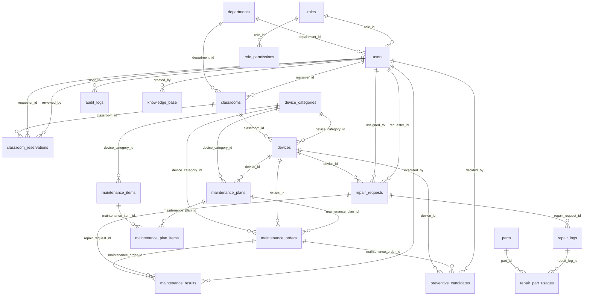

# 資料庫命名規範與資料字典

> 這是**唯一一份**資料庫文件：命名邏輯、代碼值、例外、正規化結論、資料表一覽、ERD、完整名稱清單與資料字典，以及和規格書的差異都在這裡。
> 內容是從實際的資料庫結構**自動產生**的（`php artisan docs:schema`）；資料庫異動請改 migration，再重新產生。
> 命名規則由 `DatabaseNamingConventionTest` 自動檢查、文件過期由 `SchemaDocsAreUpToDateTest` 檢查，不合規則或忘了更新都會測試失敗。

| 章節 | 內容 |
|---|---|
| 1 | 取名邏輯（設計原則、欄位 12 條規則、資料表 8 條規則、取名步驟、固定詞彙表） |
| 2 | 代碼值清單（資料庫裡真正存的值） |
| 3 | 例外清單與理由 |
| 4 | 正規化檢查結果 |
| 5 | 資料表一覽 |
| 6 | ERD |
| 7 | 完整名稱清單與資料字典（每張表的每個欄位） |
| 8 | 與規格書第 8 章資料字典的差異 |
| 9 | 定案紀錄（決定原則、資料表名稱、欄位與資料值改名對照） |

## 1. 取名邏輯

### 1.1 設計原則

1. **看名字就知道是什麼**：不用縮寫，不用同義詞混著用（同一件事全專案只有一種叫法）。
2. **由型態決定結尾**：布林用 `is_`／`has_` 開頭，時間用 `_at`，日期用 `_date`，時刻用 `_time`；看到結尾就知道怎麼用。
3. **由用途決定名詞**：名稱 `name`、標題 `title`、說明 `description`、備註 `note`、原因 `reason`、狀態 `status`、代碼 `<實體>_code`。
4. **關聯一律有外鍵，名字寫出指向誰**：`device_id` 指向 `devices`；指向人的有固定寫法（見規則 N4）。
5. **規格書已有的名稱優先沿用**（例外與理由列在第 3 節）；規格書沒有的，才依這份規則取名。
6. 全部小寫英文、單字用底線分開（snake_case）；中文只出現在說明與畫面，不出現在資料表與欄位名稱。

### 1.2 規則表

| 編號 | 對象 | 規則 | 正確範例 | 錯誤範例 |
|---|---|---|---|---|
| N1 | 資料表 | 小寫英文、底線分隔、**複數名詞**；多對多的關聯表用「兩邊的名詞」；每張表都有 `id`、`created_at`、`updated_at`（需保留履歷的主檔再加 `deleted_at`） | `devices`、`maintenance_plan_items`、`role_permissions` | `Device`、`repairRequest`、`device_list` |
| N2 | 主鍵 | 單一欄位，一律叫 `id` | `devices.id` | `device_id` 當主鍵 |
| N3 | 指向其他資料表的欄位 | `<被指向的資料表（單數）>_id`，並且一定要有外鍵約束 | `device_category_id` → `device_categories` | `category`（存文字）、`cat_id` |
| N4 | 指向「人」（users）的欄位 | 只有四種寫法：**提出者** `requester_id`；**管理人** `manager_id`；**被指派者** `assigned_to`；**做了某個動作的人** `<動詞過去分詞>_by`（`created_by`、`reviewed_by`、`executed_by`、`decided_by`）；日誌的**操作人**固定叫 `user_id` | `repair_requests.requester_id`、`classrooms.manager_id` | `reporter_id`、`username`（欄位名稱不代表帳號用途時）、`technician`（存姓名） |
| N5 | 布林 | `is_` 或 `has_` 開頭 | `is_active`、`is_core`、`is_published` | `active`、`enabled` |
| N6 | 時間 | 日期加時刻用 `_at`；只有日期用 `_date`；只有時刻用 `_time`；期間用 `_days`／`_hours` | `reviewed_at`、`reservation_date`、`start_time`、`cycle_days` | `review_time`（其實是日期時間）、`date1` |
| N7 | 狀態 | 狀態機叫 `status`；某一方面的狀態叫 `<方面>_status`；值是小寫英文加底線（過去分詞或形容詞） | `status`、`reservation_status`、`ng_conversion_status` | `state`、`flag`、`statusCode` |
| N8 | 代碼與名稱 | 給人看的業務代碼叫 `<實體>_code`（會印在標籤、表單、網址上，所以保留實體名稱）；稱呼叫 `name`（`<名詞>_name` 只用在「沒有自己資料表的另一個東西」的名稱，例如預約的 `class_name`）；文件類紀錄的標題叫 `title` | `device_code`、`classroom_code`、`role_code`、`name`、`title` | `code`（單獨一個）、`slug`、`room_no`、`caption` |
| N9 | 說明、備註、原因 | 實體本身的說明叫 `description`；操作人員填的備註用**單數** `note`（針對某件事的備註叫 `<事>_note`）；理由叫 `<事>_reason` | `description`、`note`、`decision_note`、`rejection_reason` | `notes`、`remarks`、`comment` |
| N10 | 數量與金額 | 用「單位」當結尾：`_days`、`_hours`、`_stock`、`_price`、`_bytes`、`quantity` | `cycle_days`、`unit_price`、`current_stock` | `days`（不知道是什麼）、`price1` |
| N11 | 多型關聯 | `<名詞>_type` ＋ `<名詞>_id`，不加外鍵 | `attachable_type`／`attachable_id` | — |
| N12 | JSON 欄位 | 只用在「當時的快照」或「不會單獨查詢的內容」，名稱用名詞；能拆成欄位或資料表的就不要用 JSON | `changes`、`explanation`、`features` | 用 JSON 存一串權限（已拆成 `role_permissions`） |

### 1.3 替新欄位取名的步驟

1. **它存的是什麼型態？** 布林 → N5；日期時間 → N6；狀態 → N7；數量金額 → N10。型態決定結尾，先定結尾。
2. **它是關聯嗎？** 指向別的資料表 → N3，一定要加外鍵；指向人 → N4（提出者／管理人／被指派者／做了動作的人，四選一）。
3. **它是名稱、代碼、標題、說明、備註、原因的哪一種？** 對照 N8、N9，用固定的那個字。
4. **這個值能由別的欄位算出來嗎？** 能的話不要另存（第三正規化）；真的要存（為了效能或規格書要求），在這份文件第 4 節寫明理由。
5. **一個欄位只放一個值嗎？** 需要放「很多個」的話，另開資料表，不要用逗號或 JSON（第一正規化）。
6. 規格書第 8 章已經有這個欄位的話，先沿用它的名稱；不合規則就記在第 3 節的例外清單。
7. 寫完後執行 `php artisan test --filter=DatabaseNamingConventionTest`，再執行 `php artisan docs:schema` 更新文件。

### 1.4 詞彙表（固定用字）

| 概念 | 固定用字 | 不要用 |
|---|---|---|
| 提出報修／預約的人 | requester | reporter、applicant、user |
| 被指派處理的人 | assigned_to（技術人員） | assignee_note、technician（文字） |
| 建立資料的人 | created_by | author、owner |
| 審核的人 | reviewed_by（預約）／decided_by（AI 候選） | approver |
| 保養的執行人 | executed_by | operator（文字姓名） |
| 設備類別 | device_category | category（單獨使用）、type |
| 啟用／停用 | is_active | enabled、status = active |
| 軟刪除（保留履歷的刪除） | deleted_at | is_deleted |
| 備註 | note | notes、remark、comment |
| 說明 | description | desc、detail、memo |
| 代碼 | <實體>_code（device_code、classroom_code、role_code） | code、no、number、slug |
| 登入帳號 | account | username、login_name |
| 教室 | classroom（欄位與資料表都用 classroom，不用 room） | room |
| 名稱 | name | title（只用於文件類紀錄）、label、room_name |
| 工時 | total_hours | labor_time、duration |
| 週期 | cycle_days | period、interval |

### 1.5 資料表命名邏輯

資料表名稱和欄位一樣，用「公式」組出來，看名稱就知道它屬於哪一塊業務、是哪一種表：

```
資料表名稱 ＝ ［領域詞］＿實體詞（複數）
```

| 編號 | 規則 | 說明 | 範例 |
|---|---|---|---|
| T1 | 小寫英文、單字用底線、**複數** | 表裡裝的是「很多筆」，所以用複數 | `devices`、`repair_requests` |
| T2 | 核心主檔只用單一名詞 | 大家都知道它是什麼，不需要領域詞 | `users`、`devices`、`classrooms`、`parts` |
| T3 | 其他表用「領域詞＿實體詞」 | 領域詞放前面，同一塊業務的表在清單裡會排在一起 | `maintenance_orders`、`repair_logs`、`classroom_reservations` |
| T4 | 領域詞只能用固定清單 | 避免同一塊業務出現兩種前綴；新增領域詞要先加進清單（測試會擋） | 見下表 |
| T5 | 明細或關聯表：上層的單數＋下層的複數 | 讓人從名稱看出「誰底下的什麼」 | `maintenance_plan_items`（計畫底下的項目）、`role_permissions`（身分底下的權限） |
| T6 | 結尾詞表示類型 | 紀錄／日誌用 `_logs`，設定用 `_settings`，單據用 `_requests`／`_orders`／`_reservations`，候選用 `_candidates` | `audit_logs`、`ai_settings` |
| T7 | 表名用詞和欄位用詞一致 | 表叫 `device_categories`，指向它的欄位就叫 `device_category_id`，同一概念不換說法 | `devices.device_category_id` |
| T8 | 不加無意義的前綴與縮寫 | 不用 `tbl_`、`t_`、模組縮寫 | `devices`（不是 `tbl_dev`） |

領域詞清單（T4）：

| 領域詞 | 代表的業務 | 目前使用它的資料表 |
|---|---|---|
| `ai` | AI 預測性維護 | `ai_settings` |
| `audit` | 稽核與操作日誌 | `audit_logs` |
| `classroom` | 教室與空間預約 | `classroom_reservations` |
| `device` | 設備 | `device_categories` |
| `maintenance` | 定期保養 | `maintenance_items`、`maintenance_plans`、`maintenance_plan_items`、`maintenance_orders`、`maintenance_results` |
| `preventive` | 預防保養（AI 候選） | `preventive_candidates` |
| `repair` | 報修與維修 | `repair_requests`、`repair_logs`、`repair_part_usages` |
| `role` | 身分與權限 | `role_permissions` |

資料表的類型（對應 T6 的結尾詞）：

| 類型 | 意思 | 例子 |
|---|---|---|
| 主檔 | 長期存在、被別的資料引用的基本資料 | `devices`、`classrooms`、`roles` |
| 單據 | 一筆業務事件，會經過狀態變化 | `repair_requests`、`maintenance_orders`、`classroom_reservations` |
| 明細 | 掛在某張單據或主檔底下的細項、結果 | `maintenance_results`、`repair_part_usages` |
| 關聯明細 | 兩邊多對多的中間表，或「一對多、一個值一列」的拆表（第一正規化） | `maintenance_plan_items`、`role_permissions` |
| 紀錄 | 只新增、不修改的歷史（稽核、處理過程） | `audit_logs`、`repair_logs` |
| 設定 | 系統參數 | `ai_settings` |
| 附屬（多型） | 可以掛在多種資料底下的附件 | `attachments` |

每張資料表怎麼拆解、屬於哪一類，見第 5 節的資料表一覽。

## 2. 代碼值清單（資料庫裡真正存的值）

代碼值一律是**小寫英文加底線**，狀態用形容詞或過去分詞；畫面顯示的中文走語言檔（`lang/`），不存進資料庫。

| 資料表.欄位 | 值 | 中文 |
|---|---|---|
| `repair_requests.status` | `pending` | 新報修 |
| `repair_requests.status` | `assigned` | 已派工 |
| `repair_requests.status` | `in_progress` | 處理中 |
| `repair_requests.status` | `pending_review` | 待驗收 |
| `repair_requests.status` | `completed` | 已結案 |
| `repair_requests.impact_level` | `low` | 輕微 |
| `repair_requests.impact_level` | `medium` | 中等 |
| `repair_requests.impact_level` | `high` | 嚴重 |
| `devices.status` | `normal` | 正常 |
| `devices.status` | `repairing` | 維修中 |
| `devices.status` | `retired` | 已淘汰 |
| `devices.status` | `disabled` | 停用 |
| `classrooms.reservation_status` | `normal` | 正常（可預約） |
| `classrooms.reservation_status` | `abnormal` | 有核心設備異常（不開放預約） |
| `classroom_reservations.status` | `pending` | 待審核 |
| `classroom_reservations.status` | `approved` | 已核准 |
| `classroom_reservations.status` | `rejected` | 已駁回 |
| `maintenance_orders.status` | `pending` | 待處理 |
| `maintenance_orders.status` | `in_progress` | 進行中 |
| `maintenance_orders.status` | `completed` | 已完成 |
| `maintenance_orders.source` | `periodic` | 定期 |
| `maintenance_orders.source` | `ai` | AI 預防 |
| `maintenance_results.result` | `ok` | 正常 |
| `maintenance_results.result` | `ng` | 異常 |
| `maintenance_results.ng_conversion_status` | `pending_handoff` | 待轉報修 |
| `maintenance_results.ng_conversion_status` | `not_applicable` | 不需轉報修 |
| `maintenance_results.ng_conversion_status` | `converted` | 已轉成報修單 |
| `preventive_candidates.status` | `pending` | 待審核 |
| `preventive_candidates.status` | `approved` | 已核准建單 |
| `preventive_candidates.status` | `rejected` | 已駁回 |
| `preventive_candidates.status` | `auto_created` | 自動建單 |
| `preventive_candidates.status` | `duplicate` | 重複未建單 |
| `audit_logs.action` | `created` | 新增 |
| `audit_logs.action` | `updated` | 修改 |
| `audit_logs.action` | `deleted` | 刪除 |
| `audit_logs.action` | `assigned` | 派工 |
| `audit_logs.action` | `reassigned` | 重新指派 |
| `audit_logs.action` | `status_changed` | 狀態變更 |
| `audit_logs.action` | `logged_in` | 登入 |
| `audit_logs.action` | `logged_out` | 登出 |
| `audit_logs.action` | `login_failed` | 登入失敗 |

## 3. 例外清單（不照規則、但有理由）

| 對象 | 不符合的地方 | 理由 |
|---|---|---|
| 資料表 knowledge_base | 單數 | 工作計畫與規格文件固定使用 knowledge_base 這個名稱，不改。 |
| classroom_reservations.class_name | 名稱欄位不叫 name | 它是「預約的班級名稱」（例如一年一班），班級不是一張資料表、也不是這筆預約本身，所以用 <名詞>_name；規則：<名詞>_name 只用在「另一個沒有自己資料表的東西」的名稱。 |
| attachments.file_name | 名稱欄位不叫 name | 附件記錄的就是一個檔案，檔名與 file_path（路徑）成對，也沿用規格書 attachments.file_name 的名稱。 |
| devices.asset_code | 代碼前綴不是自己的實體（device_） | 資產編號是設備身上「另一種編號」（學校財產編號），前綴用它所屬的東西 asset；設備自己的代碼仍是 device_code。 |
| audit_logs.user_id | 指向使用者卻不叫 requester_id／*_by | 它是「操作人」，是日誌的固定欄位，名稱沿用規格書 audit_logs.user_id。 |
| audit_logs.action 的值 login_failed | 不是 <動詞>_ed 的形式 | 「登入失敗」本來就是一個名詞片語，保持 login_failed；其餘動作值都是過去式（created、logged_in、logged_out…）。 |
| 主鍵一律叫 id | 規格書第 8 章寫 user_id、device_id… | 彭仕衡決定保留 Laravel 慣例，主鍵一律 id；外鍵才用 <表單數>_id（見第 8、9 節）。 |

例外清單同時寫在 `DatabaseNamingConventionTest` 裡；新增例外要兩邊一起改。

## 4. 正規化檢查結果

檢查標準：第一正規化（一個欄位一個值）、第二正規化（沒有只依賴一部分主鍵的欄位）、第三正規化（沒有可以由別的欄位推出來的欄位）。

| 資料表 | 中文名稱 | 結論 |
|---|---|---|
| `roles` | 角色主檔（身分） | 符合 3NF。勾選的權限原本是 JSON 陣列（違反 1NF），已拆成 role_permissions。 |
| `role_permissions` | 身分權限 | 關聯表：一列一個權限；(role_id, permission) 唯一，身分刪除時一起刪除。 |
| `departments` | 單位主檔 | 符合 3NF。 |
| `users` | 使用者主檔 | 符合 3NF。一人一個身分（role_id），所屬單位以 department_id 關聯。 |
| `classrooms` | 教室主檔 | 大致符合 3NF，有兩個有意保留的例外：campus／building／floor 依規格書 4.1 直接存在教室上（同一大樓的多間教室會重複同一段文字）；reservation_status 是由「核心設備狀態」推得的快取旗標，由 DeviceStatusService 維護，避免每次列表都重算（是否保留屬待確認事項）。 |
| `device_categories` | 設備類別 | 符合 3NF。 |
| `devices` | 設備主檔 | 符合 3NF。類別與教室只存外鍵；brand／model 依規格書是文字欄位。 |
| `maintenance_items` | 保養項目 | 符合 3NF。適用設備類別以 device_category_id 關聯（原本是自由文字）。 |
| `maintenance_plans` | 保養計畫 | 符合 3NF。針對「一台設備」或「一類設備」二選一，指定設備後類別由設備推得、不另存。next_due_date 是由 start_date 加週期推得的值，排程要用，所以保留。 |
| `maintenance_plan_items` | 保養計畫明細 | 純關聯表（多對多），符合 2NF／3NF。 |
| `maintenance_orders` | 保養工單 | 符合 3NF（設備與類別二選一，理由同保養計畫）。 |
| `maintenance_results` | 保養結果 | 符合 3NF。執行人以 executed_by（users.id）關聯，不再存姓名文字。ng_conversion_status 與 repair_request_id 有部分重疊（converted 代表已有報修單），因為還需要區分「待轉」與「不需轉」兩種沒有報修單的情況，所以保留。 |
| `repair_requests` | 報修單 | 大致符合 3NF。維修人員只存 assigned_to（原本另存 assignee_note 文字，已移除）。device_note／location 是「沒有綁定設備」時的後備文字，有綁設備時可由設備與教室推得（保留為歷史與手動輸入用）。 |
| `repair_logs` | 維修紀錄 | 大致符合 3NF。total_hours 是由起訖時間推得的值，規格書要求存起來所以保留；parts_used_note 是自由文字備註，結構化的備品使用已改存 repair_part_usages（舊資料與額外說明仍可寫在這裡）。 |
| `repair_part_usages` | 維修零件使用明細 | 符合 3NF。unit_price 是「使用當下的單價快照」，刻意和 parts.unit_price 分開存（零件日後調價不影響歷史成本），不算重複。 |
| `attachments` | 附件資料 | 符合 3NF。用 Laravel 多型關聯（attachable_type + attachable_id）指向報修單、維修紀錄等，不加外鍵。 |
| `audit_logs` | 操作日誌 | 日誌資料。changes 是 JSON：記錄「當時」的變更內容快照，不需要單獨查詢內容，所以刻意不拆成欄位（1NF 的有意例外）。 |
| `knowledge_base` | 自助知識庫文章 | 符合 3NF。category 是自由文字（沒有獨立的分類表）；值很少、也沒有跨表查詢需求，若日後分類變多再拆成獨立資料表。 |
| `parts` | 零件庫存 | 符合 3NF。 |
| `classroom_reservations` | 教室預約申請 | 符合 3NF。 |
| `ai_settings` | AI 預防保養參數 | 「參數名稱＋參數值」的設定表（key-value），參數會隨功能增減，所以刻意不為每個參數開一個欄位。 |
| `preventive_candidates` | 預防保養候選 | 符合 3NF。explanation／features 是 JSON：當時評分的快照（日後改規則也要能重現當時結果），有意不拆。 |

### 本次整理做過的正規化與統一名稱

| 類型 | 內容 |
|---|---|
| 1NF | `roles.permissions`（JSON 陣列）拆成 `role_permissions`（一列一個權限，身分與權限代碼唯一）。 |
| 3NF | 保養計畫、保養工單指定了設備（`device_id`）後，不再另存 `device_category_id`（由設備推得，儲存時自動清除）。 |
| 3NF／外鍵 | 保養項目、計畫、工單的設備類別：自由文字 → `device_category_id`；保養執行人：文字姓名 → `executed_by`（users.id）；報修單的 `assignee_note` 文字移除，只留 `assigned_to`。 |
| 完整性 | 補上 4 個缺少的外鍵約束（保養工單／計畫的 `device_id`、保養結果的 `repair_request_id`、知識庫的 `created_by`）。 |
| 名稱統一 | `reporter_id`、`user_id`（預約）→ `requester_id`；`departments.code` → `department_code`；`maintenance_results.notes` → `note`；`repair_part_usage` → `repair_part_usages`。 |

## 5. 資料表一覽

| 資料表 | 中文名稱 | 類型 | 名稱拆解（領域詞＋實體詞） | 欄位數 | 規格書對照 |
|---|---|---|---|---|---|
| `roles` | 角色主檔（身分） | 主檔 | （核心主檔）＋ `roles` | 7 | 第 7 章 roles |
| `role_permissions` | 身分權限 | 關聯明細 | `role` ＋ `permissions` | 5 | 規格書未列（roles 權限描述的正規化結果） |
| `departments` | 單位主檔 | 主檔 | （核心主檔）＋ `departments` | 7 | 第 7 章 departments |
| `users` | 使用者主檔 | 主檔 | （核心主檔）＋ `users` | 15 | 第 7 章 users |
| `classrooms` | 教室主檔 | 主檔 | （核心主檔）＋ `classrooms` | 14 | 第 7 章 classrooms |
| `device_categories` | 設備類別 | 主檔 | `device` ＋ `categories` | 4 | 第 7 章 device_categories |
| `devices` | 設備主檔 | 主檔 | （核心主檔）＋ `devices` | 14 | 第 7 章 devices |
| `maintenance_items` | 保養項目 | 主檔 | `maintenance` ＋ `items` | 8 | 第 7 章 maintenance_items |
| `maintenance_plans` | 保養計畫 | 主檔 | `maintenance` ＋ `plans` | 10 | 第 7 章 maintenance_plans |
| `maintenance_plan_items` | 保養計畫明細 | 關聯明細 | `maintenance_plan` ＋ `items` | 5 | 第 7 章 maintenance_plan_items |
| `maintenance_orders` | 保養工單 | 單據 | `maintenance` ＋ `orders` | 9 | 第 7 章 maintenance_orders |
| `maintenance_results` | 保養結果 | 明細 | `maintenance` ＋ `results` | 10 | 第 7 章 maintenance_results |
| `repair_requests` | 報修單 | 單據 | `repair` ＋ `requests` | 15 | 第 7 章 repair_requests |
| `repair_logs` | 維修紀錄 | 紀錄 | `repair` ＋ `logs` | 10 | 第 7 章 repair_logs |
| `repair_part_usages` | 維修零件使用明細 | 明細 | `repair` ＋ `part_usages` | 7 | 規格書未列（備品使用的結構化） |
| `attachments` | 附件資料 | 附屬（多型） | （核心主檔）＋ `attachments` | 9 | 第 7 章 attachments |
| `audit_logs` | 操作日誌 | 紀錄 | `audit` ＋ `logs` | 9 | 第 7 章 audit_logs |
| `knowledge_base` | 自助知識庫文章 | 主檔（例外） | （核心主檔）＋ `knowledge_base` | 9 | 規格書未列（工作計畫指定模組） |
| `parts` | 零件庫存 | 主檔 | （核心主檔）＋ `parts` | 8 | 規格書未列（備品庫存模組） |
| `classroom_reservations` | 教室預約申請 | 單據 | `classroom` ＋ `reservations` | 14 | 規格書未列（空間預約模組） |
| `ai_settings` | AI 預防保養參數 | 設定 | `ai` ＋ `settings` | 5 | 規格書未列（AI 預測性維護） |
| `preventive_candidates` | 預防保養候選 | 單據 | `preventive` ＋ `candidates` | 14 | 規格書未列（AI 預測性維護） |

## 6. ERD（資料表關聯）



## 7. 完整名稱清單與資料字典

欄位順序固定：編號 → 關聯（外鍵）→ 一般欄位 → 時間欄位。「類別」欄是這個名稱適用的規則（對照第 1.2 節）；型態是邏輯型態（整數、文字、布林…），不隨資料庫軟體而變。

| 類別 | 適用規則 |
|---|---|
| PK | N2 |
| FK-表 | N3 |
| FK-人 | N4 |
| 布林 | N5 |
| 時間／日期／時刻 | N6 |
| 狀態 | N7 |
| 代碼／名稱／標題 | N8 |
| 文字說明 | N9 |
| 數量／金額 | N10 |
| 多型關聯 | N11 |
| JSON | N12 |
| 一般 | 無特別規則（名詞，小寫底線） |

### roles　角色主檔（身分）

| 欄位名稱 | 類別 | 型態 | 必填 | 唯一 | 外鍵 | 說明 |
|---|---|---|---|---|---|---|
| `id` | PK | 整數 |  |  |  | 系統自動編號（主鍵） |
| `description` | 文字說明 | 文字 |  |  |  | 說明 |
| `is_system` | 布林 | 布林 | Y |  |  | 是否系統內建身分（內建的不能刪除） |
| `name` | 名稱 | 文字 | Y |  |  | 身分名稱 |
| `role_code` | 代碼 | 文字 | Y | Y |  | 身分代碼（程式判斷用，唯一） |
| `created_at` | 時間 | 日期時間 |  |  |  | 建立時間 |
| `updated_at` | 時間 | 日期時間 |  |  |  | 最後修改時間 |

### role_permissions　身分權限

| 欄位名稱 | 類別 | 型態 | 必填 | 唯一 | 外鍵 | 說明 |
|---|---|---|---|---|---|---|
| `id` | PK | 整數 |  |  |  | 系統自動編號（主鍵） |
| `role_id` | FK-表 | 整數 | Y |  | `roles.id` | 所屬身分 |
| `permission` | 一般 | 文字 | Y |  |  | 權限代碼（格式「功能.動作」，清單見 PermissionCatalog） |
| `created_at` | 時間 | 日期時間 |  |  |  | 建立時間 |
| `updated_at` | 時間 | 日期時間 |  |  |  | 最後修改時間 |

### departments　單位主檔

| 欄位名稱 | 類別 | 型態 | 必填 | 唯一 | 外鍵 | 說明 |
|---|---|---|---|---|---|---|
| `id` | PK | 整數 |  |  |  | 系統自動編號（主鍵） |
| `department_code` | 代碼 | 文字 |  | Y |  | 部門代碼（唯一） |
| `description` | 文字說明 | 文字 |  |  |  | 說明 |
| `is_active` | 布林 | 布林 | Y |  |  | 是否啟用 |
| `name` | 名稱 | 文字 | Y |  |  | 單位名稱 |
| `created_at` | 時間 | 日期時間 |  |  |  | 建立時間 |
| `updated_at` | 時間 | 日期時間 |  |  |  | 最後修改時間 |

### users　使用者主檔

| 欄位名稱 | 類別 | 型態 | 必填 | 唯一 | 外鍵 | 說明 |
|---|---|---|---|---|---|---|
| `id` | PK | 整數 |  |  |  | 系統自動編號（主鍵） |
| `department_id` | FK-表 | 整數 |  |  | `departments.id` | 所屬單位 |
| `role_id` | FK-表 | 整數 |  |  | `roles.id` | 所屬身分 |
| `account` | 一般 | 文字 |  | Y |  | 登入帳號（唯一） |
| `email` | 一般 | 文字 | Y | Y |  | 電子信箱 |
| `email_verified_at` | 時間 | 日期時間 |  |  |  | Email 驗證時間 |
| `is_active` | 布林 | 布林 | Y |  |  | 是否啟用 |
| `last_login_at` | 時間 | 日期時間 |  |  |  | 最後登入時間 |
| `name` | 名稱 | 文字 | Y |  |  | 名稱 |
| `password` | 一般 | 文字 | Y |  |  | 密碼（雜湊後儲存，不存明碼） |
| `phone` | 一般 | 文字 |  |  |  | 電話 |
| `remember_token` | 一般 | 文字 |  |  |  | 「記住我」登入憑證 |
| `created_at` | 時間 | 日期時間 |  |  |  | 建立時間 |
| `updated_at` | 時間 | 日期時間 |  |  |  | 最後修改時間 |
| `deleted_at` | 時間 | 日期時間 |  |  |  | 軟刪除時間（有值代表已停用／刪除，資料保留供履歷追溯） |

### classrooms　教室主檔

| 欄位名稱 | 類別 | 型態 | 必填 | 唯一 | 外鍵 | 說明 |
|---|---|---|---|---|---|---|
| `id` | PK | 整數 |  |  |  | 系統自動編號（主鍵） |
| `department_id` | FK-表 | 整數 |  |  | `departments.id` | 所屬單位 |
| `manager_id` | FK-人 | 整數 |  |  | `users.id` | 教室管理人（users.id） |
| `building` | 一般 | 文字 | Y |  |  | 大樓 |
| `campus` | 一般 | 文字 | Y |  |  | 校區 |
| `classroom_code` | 代碼 | 文字 | Y | Y |  | 教室代碼（唯一） |
| `floor` | 一般 | 文字 | Y |  |  | 樓層 |
| `is_active` | 布林 | 布林 | Y |  |  | 是否啟用 |
| `name` | 名稱 | 文字 | Y |  |  | 教室名稱 |
| `reservation_status` | 狀態 | 列舉 | Y |  |  | 設備異常旗標（normal 正常／abnormal 有核心設備異常，異常時不開放預約）（值：normal 正常（可預約）／abnormal 有核心設備異常（不開放預約）） |
| `type` | 一般 | 文字 |  |  |  | 教室類型 |
| `created_at` | 時間 | 日期時間 |  |  |  | 建立時間 |
| `updated_at` | 時間 | 日期時間 |  |  |  | 最後修改時間 |
| `deleted_at` | 時間 | 日期時間 |  |  |  | 軟刪除時間（有值代表已停用／刪除，資料保留供履歷追溯） |

### device_categories　設備類別

| 欄位名稱 | 類別 | 型態 | 必填 | 唯一 | 外鍵 | 說明 |
|---|---|---|---|---|---|---|
| `id` | PK | 整數 |  |  |  | 系統自動編號（主鍵） |
| `name` | 名稱 | 文字 | Y | Y |  | 類別名稱（唯一） |
| `created_at` | 時間 | 日期時間 |  |  |  | 建立時間 |
| `updated_at` | 時間 | 日期時間 |  |  |  | 最後修改時間 |

### devices　設備主檔

| 欄位名稱 | 類別 | 型態 | 必填 | 唯一 | 外鍵 | 說明 |
|---|---|---|---|---|---|---|
| `id` | PK | 整數 |  |  |  | 系統自動編號（主鍵） |
| `classroom_id` | FK-表 | 整數 | Y |  | `classrooms.id` | 所在教室（classrooms.id） |
| `device_category_id` | FK-表 | 整數 | Y |  | `device_categories.id` | 設備類別（device_categories.id） |
| `asset_code` | 代碼 | 文字 |  |  |  | 資產編號 |
| `brand` | 一般 | 文字 |  |  |  | 品牌／製造商 |
| `device_code` | 代碼 | 文字 | Y | Y |  | 設備管制編號（唯一，QR Code 內容） |
| `is_core` | 布林 | 布林 | Y |  |  | 是否核心設備（異常時整間教室標示異常） |
| `model` | 一般 | 文字 |  |  |  | 型號規格 |
| `serial_number` | 一般 | 文字 |  |  |  | 序號 |
| `status` | 狀態 | 文字 | Y |  |  | 狀態（值：normal 正常／repairing 維修中／retired 已淘汰／disabled 停用） |
| `warranty_end_date` | 日期 | 日期 |  |  |  | 保固到期日 |
| `created_at` | 時間 | 日期時間 |  |  |  | 建立時間 |
| `updated_at` | 時間 | 日期時間 |  |  |  | 最後修改時間 |
| `deleted_at` | 時間 | 日期時間 |  |  |  | 軟刪除時間（有值代表已停用／刪除，資料保留供履歷追溯） |

### maintenance_items　保養項目

| 欄位名稱 | 類別 | 型態 | 必填 | 唯一 | 外鍵 | 說明 |
|---|---|---|---|---|---|---|
| `id` | PK | 整數 |  |  |  | 系統自動編號（主鍵） |
| `device_category_id` | FK-表 | 整數 |  |  | `device_categories.id` | 設備類別（device_categories.id） |
| `default_cycle_days` | 數量／金額 | 整數 |  |  |  | 預設保養週期（天） |
| `description` | 文字說明 | 長文字 |  |  |  | 說明 |
| `is_active` | 布林 | 布林 | Y |  |  | 是否啟用 |
| `name` | 名稱 | 文字 | Y |  |  | 項目名稱 |
| `created_at` | 時間 | 日期時間 |  |  |  | 建立時間 |
| `updated_at` | 時間 | 日期時間 |  |  |  | 最後修改時間 |

### maintenance_plans　保養計畫

| 欄位名稱 | 類別 | 型態 | 必填 | 唯一 | 外鍵 | 說明 |
|---|---|---|---|---|---|---|
| `id` | PK | 整數 |  |  |  | 系統自動編號（主鍵） |
| `device_category_id` | FK-表 | 整數 |  |  | `device_categories.id` | 設備類別（device_categories.id） |
| `device_id` | FK-表 | 整數 |  |  | `devices.id` | 設備（devices.id） |
| `cycle_days` | 數量／金額 | 整數 | Y |  |  | 保養週期（天） |
| `is_active` | 布林 | 布林 | Y |  |  | 是否啟用 |
| `name` | 名稱 | 文字 | Y |  |  | 計畫名稱 |
| `next_due_date` | 日期 | 日期 |  |  |  | 下次到期日 |
| `start_date` | 日期 | 日期 | Y |  |  | 基準日期（排程計算起點） |
| `created_at` | 時間 | 日期時間 |  |  |  | 建立時間 |
| `updated_at` | 時間 | 日期時間 |  |  |  | 最後修改時間 |

### maintenance_plan_items　保養計畫明細

| 欄位名稱 | 類別 | 型態 | 必填 | 唯一 | 外鍵 | 說明 |
|---|---|---|---|---|---|---|
| `id` | PK | 整數 |  |  |  | 系統自動編號（主鍵） |
| `maintenance_item_id` | FK-表 | 整數 | Y |  | `maintenance_items.id` | 保養項目 |
| `maintenance_plan_id` | FK-表 | 整數 | Y |  | `maintenance_plans.id` | 來源保養計畫 |
| `created_at` | 時間 | 日期時間 |  |  |  | 建立時間 |
| `updated_at` | 時間 | 日期時間 |  |  |  | 最後修改時間 |

### maintenance_orders　保養工單

| 欄位名稱 | 類別 | 型態 | 必填 | 唯一 | 外鍵 | 說明 |
|---|---|---|---|---|---|---|
| `id` | PK | 整數 |  |  |  | 系統自動編號（主鍵） |
| `device_category_id` | FK-表 | 整數 |  |  | `device_categories.id` | 設備類別（device_categories.id） |
| `device_id` | FK-表 | 整數 |  |  | `devices.id` | 設備（devices.id） |
| `maintenance_plan_id` | FK-表 | 整數 |  |  | `maintenance_plans.id` | 來源保養計畫 |
| `scheduled_date` | 日期 | 日期 |  |  |  | 預定保養日 |
| `source` | 一般 | 文字 | Y |  |  | 來源（值：periodic 定期／ai AI 預防） |
| `status` | 狀態 | 文字 | Y |  |  | 狀態（值：pending 待處理／in_progress 進行中／completed 已完成） |
| `created_at` | 時間 | 日期時間 |  |  |  | 建立時間 |
| `updated_at` | 時間 | 日期時間 |  |  |  | 最後修改時間 |

### maintenance_results　保養結果

| 欄位名稱 | 類別 | 型態 | 必填 | 唯一 | 外鍵 | 說明 |
|---|---|---|---|---|---|---|
| `id` | PK | 整數 |  |  |  | 系統自動編號（主鍵） |
| `executed_by` | FK-人 | 整數 |  |  | `users.id` | 執行人（users.id，由登入帳號帶入） |
| `maintenance_order_id` | FK-表 | 整數 | Y | Y | `maintenance_orders.id` | 所屬保養工單 |
| `repair_request_id` | FK-表 | 整數 |  |  | `repair_requests.id` | 報修單（repair_requests.id） |
| `executed_at` | 時間 | 日期時間 | Y |  |  | 執行時間 |
| `ng_conversion_status` | 狀態 | 文字 |  |  |  | NG 轉報修狀態（值：pending_handoff 待轉報修／not_applicable 不需轉報修／converted 已轉成報修單） |
| `note` | 文字說明 | 長文字 |  |  |  | 備註（操作人員填寫） |
| `result` | 一般 | 文字 | Y |  |  | 結果（值：ok 正常／ng 異常） |
| `created_at` | 時間 | 日期時間 |  |  |  | 建立時間 |
| `updated_at` | 時間 | 日期時間 |  |  |  | 最後修改時間 |

### repair_requests　報修單

| 欄位名稱 | 類別 | 型態 | 必填 | 唯一 | 外鍵 | 說明 |
|---|---|---|---|---|---|---|
| `id` | PK | 整數 |  |  |  | 系統自動編號（主鍵） |
| `assigned_to` | FK-人 | 整數 |  |  | `users.id` | 指派的維修人員（users.id） |
| `device_id` | FK-表 | 整數 |  |  | `devices.id` | 設備（devices.id） |
| `requester_id` | FK-人 | 整數 |  |  | `users.id` | 提出者（users.id）：報修人／預約申請人 |
| `description` | 文字說明 | 長文字 | Y |  |  | 故障描述 |
| `device_note` | 文字說明 | 文字 |  |  |  | 設備說明（手動輸入、沒有綁設備時用） |
| `impact_level` | 一般 | 列舉 | Y |  |  | 影響程度（值：low 輕微／medium 中等／high 嚴重） |
| `is_class_affected` | 布林 | 布林 | Y |  |  | 是否影響上課 |
| `location` | 一般 | 文字 |  |  |  | 地點（文字） |
| `rejection_reason` | 文字說明 | 長文字 |  |  |  | 驗收退回原因 |
| `scheduled_at` | 時間 | 日期時間 |  |  |  | 預計處理時間 |
| `status` | 狀態 | 文字 | Y |  |  | 狀態（值：pending 新報修／assigned 已派工／in_progress 處理中／pending_review 待驗收／completed 已結案） |
| `title` | 標題 | 文字 | Y |  |  | 報修標題 |
| `created_at` | 時間 | 日期時間 |  |  |  | 建立時間 |
| `updated_at` | 時間 | 日期時間 |  |  |  | 最後修改時間 |

### repair_logs　維修紀錄

| 欄位名稱 | 類別 | 型態 | 必填 | 唯一 | 外鍵 | 說明 |
|---|---|---|---|---|---|---|
| `id` | PK | 整數 |  |  |  | 系統自動編號（主鍵） |
| `repair_request_id` | FK-表 | 整數 | Y |  | `repair_requests.id` | 報修單（repair_requests.id） |
| `cause` | 一般 | 長文字 | Y |  |  | 故障原因 |
| `ended_at` | 時間 | 日期時間 |  |  |  | 結束時間 |
| `parts_used_note` | 文字說明 | 文字 |  |  |  | 使用備品說明（文字備註） |
| `resolution` | 一般 | 長文字 | Y |  |  | 處置方式 |
| `started_at` | 時間 | 日期時間 |  |  |  | 起始時間 |
| `total_hours` | 數量／金額 | 小數 |  |  |  | 總工時（系統計算） |
| `created_at` | 時間 | 日期時間 |  |  |  | 建立時間 |
| `updated_at` | 時間 | 日期時間 |  |  |  | 最後修改時間 |

### repair_part_usages　維修零件使用明細

| 欄位名稱 | 類別 | 型態 | 必填 | 唯一 | 外鍵 | 說明 |
|---|---|---|---|---|---|---|
| `id` | PK | 整數 |  |  |  | 系統自動編號（主鍵） |
| `part_id` | FK-表 | 整數 | Y |  | `parts.id` | 零件（parts.id） |
| `repair_log_id` | FK-表 | 整數 | Y |  | `repair_logs.id` | 所屬維修紀錄 |
| `quantity` | 數量／金額 | 整數 | Y |  |  | 使用數量 |
| `unit_price` | 數量／金額 | 整數 |  |  |  | 單價 |
| `created_at` | 時間 | 日期時間 |  |  |  | 建立時間 |
| `updated_at` | 時間 | 日期時間 |  |  |  | 最後修改時間 |

### attachments　附件資料

| 欄位名稱 | 類別 | 型態 | 必填 | 唯一 | 外鍵 | 說明 |
|---|---|---|---|---|---|---|
| `id` | PK | 整數 |  |  |  | 系統自動編號（主鍵） |
| `attachable_id` | 多型關聯 | 整數 | Y |  |  | 附件所屬資料編號（多型） |
| `attachable_type` | 多型關聯 | 文字 | Y |  |  | 附件所屬資料類型（多型） |
| `file_name` | 名稱 | 文字 | Y |  |  | 原始檔名（使用者上傳時的檔名） |
| `file_path` | 一般 | 文字 | Y |  |  | 檔案儲存路徑（私有磁碟） |
| `mime_type` | 一般 | 文字 | Y |  |  | 檔案類型 |
| `size_bytes` | 數量／金額 | 整數 | Y |  |  | 檔案大小（位元組） |
| `created_at` | 時間 | 日期時間 |  |  |  | 建立時間 |
| `updated_at` | 時間 | 日期時間 |  |  |  | 最後修改時間 |

### audit_logs　操作日誌

| 欄位名稱 | 類別 | 型態 | 必填 | 唯一 | 外鍵 | 說明 |
|---|---|---|---|---|---|---|
| `id` | PK | 整數 |  |  |  | 系統自動編號（主鍵） |
| `user_id` | FK-人 | 整數 |  |  | `users.id` | 操作人（users.id） |
| `action` | 一般 | 文字 | Y |  |  | 操作動作（值：created 新增／updated 修改／deleted 刪除／assigned 派工／reassigned 重新指派／status_changed 狀態變更／logged_in 登入／logged_out 登出／login_failed 登入失敗） |
| `changes` | JSON | JSON |  |  |  | 變更內容（JSON 快照） |
| `description` | 文字說明 | 文字 |  |  |  | 說明 |
| `loggable_id` | 多型關聯 | 整數 |  |  |  | 被操作資料編號（多型） |
| `loggable_type` | 多型關聯 | 文字 |  |  |  | 被操作資料類型（多型） |
| `created_at` | 時間 | 日期時間 |  |  |  | 建立時間 |
| `updated_at` | 時間 | 日期時間 |  |  |  | 最後修改時間 |

### knowledge_base　自助知識庫文章

| 欄位名稱 | 類別 | 型態 | 必填 | 唯一 | 外鍵 | 說明 |
|---|---|---|---|---|---|---|
| `id` | PK | 整數 |  |  |  | 系統自動編號（主鍵） |
| `created_by` | FK-人 | 整數 |  |  | `users.id` | 建立者（users.id） |
| `category` | 一般 | 文字 |  |  |  | 分類（自由文字） |
| `is_published` | 布林 | 布林 | Y |  |  | 是否上架（未上架僅知識庫管理者可見） |
| `solution` | 一般 | 長文字 | Y |  |  | 自助排除步驟 |
| `symptom` | 一般 | 長文字 | Y |  |  | 常見故障現象 |
| `title` | 標題 | 文字 | Y |  |  | 標題 |
| `created_at` | 時間 | 日期時間 |  |  |  | 建立時間 |
| `updated_at` | 時間 | 日期時間 |  |  |  | 最後修改時間 |

### parts　零件庫存

| 欄位名稱 | 類別 | 型態 | 必填 | 唯一 | 外鍵 | 說明 |
|---|---|---|---|---|---|---|
| `id` | PK | 整數 |  |  |  | 系統自動編號（主鍵） |
| `current_stock` | 數量／金額 | 整數 | Y |  |  | 目前庫存 |
| `name` | 名稱 | 文字 | Y |  |  | 零件名稱 |
| `safety_stock` | 數量／金額 | 整數 | Y |  |  | 安全庫存 |
| `specification` | 一般 | 文字 |  |  |  | 規格 |
| `unit_price` | 數量／金額 | 整數 | Y |  |  | 單價 |
| `created_at` | 時間 | 日期時間 |  |  |  | 建立時間 |
| `updated_at` | 時間 | 日期時間 |  |  |  | 最後修改時間 |

### classroom_reservations　教室預約申請

| 欄位名稱 | 類別 | 型態 | 必填 | 唯一 | 外鍵 | 說明 |
|---|---|---|---|---|---|---|
| `id` | PK | 整數 |  |  |  | 系統自動編號（主鍵） |
| `classroom_id` | FK-表 | 整數 | Y |  | `classrooms.id` | 所在教室（classrooms.id） |
| `requester_id` | FK-人 | 整數 | Y |  | `users.id` | 提出者（users.id）：報修人／預約申請人 |
| `reviewed_by` | FK-人 | 整數 |  |  | `users.id` | 審核人（users.id） |
| `class_name` | 名稱 | 文字 | Y |  |  | 班級名稱 |
| `end_time` | 時刻 | 時刻 | Y |  |  | 結束時間 |
| `purpose` | 一般 | 文字 |  |  |  | 用途 |
| `rejection_reason` | 文字說明 | 文字 |  |  |  | 驗收退回原因 |
| `reservation_date` | 日期 | 日期 | Y |  |  | 預約日期 |
| `reviewed_at` | 時間 | 日期時間 |  |  |  | 審核時間 |
| `start_time` | 時刻 | 時刻 | Y |  |  | 開始時間 |
| `status` | 狀態 | 文字 | Y |  |  | 狀態（值：pending 待審核／approved 已核准／rejected 已駁回） |
| `created_at` | 時間 | 日期時間 |  |  |  | 建立時間 |
| `updated_at` | 時間 | 日期時間 |  |  |  | 最後修改時間 |

### ai_settings　AI 預防保養參數

| 欄位名稱 | 類別 | 型態 | 必填 | 唯一 | 外鍵 | 說明 |
|---|---|---|---|---|---|---|
| `id` | PK | 整數 |  |  |  | 系統自動編號（主鍵） |
| `key` | 一般 | 文字 | Y | Y |  | 參數名稱 |
| `value` | 一般 | 文字 |  |  |  | 參數值 |
| `created_at` | 時間 | 日期時間 |  |  |  | 建立時間 |
| `updated_at` | 時間 | 日期時間 |  |  |  | 最後修改時間 |

### preventive_candidates　預防保養候選

| 欄位名稱 | 類別 | 型態 | 必填 | 唯一 | 外鍵 | 說明 |
|---|---|---|---|---|---|---|
| `id` | PK | 整數 |  |  |  | 系統自動編號（主鍵） |
| `decided_by` | FK-人 | 整數 |  |  | `users.id` | 審核人（users.id） |
| `device_id` | FK-表 | 整數 | Y |  | `devices.id` | 設備（devices.id） |
| `maintenance_order_id` | FK-表 | 整數 |  |  | `maintenance_orders.id` | 所屬保養工單 |
| `algorithm` | 一般 | 文字 | Y |  |  | 評分演算法版本 |
| `decided_at` | 時間 | 日期時間 |  |  |  | 審核時間 |
| `decision_note` | 文字說明 | 文字 |  |  |  | 審核備註 |
| `explanation` | JSON | JSON |  |  |  | 評分明細（JSON 快照） |
| `features` | JSON | JSON |  |  |  | 輸入特徵（JSON 快照） |
| `risk_score` | 數量／金額 | 小數 | Y |  |  | 風險分數（0～1） |
| `status` | 狀態 | 文字 | Y |  |  | 狀態（值：pending 待審核／approved 已核准建單／rejected 已駁回／auto_created 自動建單／duplicate 重複未建單） |
| `threshold` | 數量／金額 | 小數 | Y |  |  | 當時的門檻 |
| `created_at` | 時間 | 日期時間 |  |  |  | 建立時間 |
| `updated_at` | 時間 | 日期時間 |  |  |  | 最後修改時間 |

## 8. 與規格書第 8 章資料字典的差異

規格書第 8 章的欄位名稱採「`表名_id` 當主鍵」的寫法；專案用的是 Laravel 慣例（主鍵一律叫 `id`）。
彭仕衡決定（2026-10-15）**保留 Laravel 慣例**，只統一專案內部不一致的地方，所以下面這些差異是**刻意保留的**，功能與規格書一致，只是名稱不同。
若指導老師要求逐字對齊規格書，要改 migration 與 Model 的 `$primaryKey`，所有外鍵欄位與四位組員的分支都要同步修改，請先全組討論。

| 規格書（第 8 章） | 專案實際 | 備註 |
|---|---|---|
| 每張表的主鍵 `role_id`、`user_id`、`device_id`… | 全部是 `id` | Laravel 慣例 |
| `users.account`、`users.password_hash` | `users.account`、`users.password` | 帳號名稱已對齊；密碼欄位沿用 Laravel 的 password，同樣是雜湊儲存 |
| `users.status`（active／inactive） | `users.is_active`（布林） | 同義 |
| `roles` 的權限描述 | `role_permissions`（一列一個權限） | 正規化後的結果，規格書只有文字描述 |
| `departments.department_name` | `departments.name`、`department_code` | 同義 |
| `classrooms.room_no`、`room_name`、`room_type`、`status`（active／inactive／repair） | `classroom_code`、`name`、`type`、`is_active` ＋ `reservation_status` | 依命名規則取名（代碼用 <實體>_code）；「整修中」另以設備異常旗標表示 |
| `devices.asset_no`、`serial_no`、`manufacturer`、`warranty_end` | `asset_code`、`serial_number`、`brand`、`warranty_end_date` | 同義；依命名規則取名（代碼 _code、日期 _date） |
| `devices.status`（normal／idle／repairing／disabled／scrapped） | normal／repairing／retired／disabled | 設備狀態完整列舉屬待確認事項，未擅自增減 |
| `repair_requests.requester_id`、`affect_class` | `requester_id`、`is_class_affected` | 提出者已對齊；布林欄位依規則加 is_ |
| `repair_requests.repair_no`、`fault_type`、`priority` | 尚無 | 規格書欄位尚未實作 |
| 報修狀態 NEW／ASSIGNED／IN_PROGRESS／WAIT_VERIFY／CLOSED／REOPEN／REJECTED | pending／assigned／in_progress／pending_review／completed | 另有「驗收退回回到處理中」；REOPEN、REJECTED 未實作 |
| `maintenance_items.category_id` | `device_category_id` | 已對齊 |
| `maintenance_results.filled_by` | `executed_by`（users.id） | 已改成外鍵 |
| `attachments.ref_type`／`ref_id`／`file_name`／`file_path`／`size_kb`／`uploaded_by` | `attachable_type`／`attachable_id`／`file_name`／`file_path`／`size_bytes`，無 `uploaded_by` | 檔名與路徑已對齊；來源用 Laravel 多型關聯；大小存位元組 |
| `audit_logs.table_name`／`record_id`／`ip_address` | `loggable_type`／`loggable_id`，無 `ip_address` | Laravel 多型關聯 |
| 規格書第 7 章 15 張表以外 | 另有 `knowledge_base`、`parts`、`repair_part_usages`、`classroom_reservations`、`ai_settings`、`preventive_candidates` | 工作計畫指定的模組 |

## 9. 定案紀錄（名稱怎麼決定的、改了什麼）

2026-10-25 由彭仕衡授權、依本文件的取名邏輯一次定案；所有名稱都已經套用到資料庫、程式、畫面、種子資料與測試。

### 9.1 決定原則（規格書和取名規則衝突時怎麼辦）

| 情況 | 決定 |
|---|---|
| 規格書第 7 章列出的資料表名稱 | 全部沿用，不改 |
| 規格書第 8 章的欄位名稱，意思相同且符合取名規則 | 沿用規格書的名稱（`account`、`file_name`、`file_path`、`mime_type`、`requester_id`…） |
| 規格書的欄位名稱違反取名規則（`room_no` 不是 `_code`、`warranty_end` 沒有 `_date`、`affect_class` 沒有 `is_`） | 依取名規則重新取名，差異記在第 8 節 |
| 規格書沒有的資料表與欄位（知識庫、零件、預約、AI） | 依取名規則取名 |
| 主鍵 | 一律 `id`（Laravel 慣例，彭仕衡決定）；外鍵才用 `<表單數>_id` |
| 工作計畫與規格文件已經固定的名稱（`knowledge_base`） | 不改，列為例外 |

### 9.2 資料表名稱：22 張全部維持

逐張對照第 1.5 節的資料表公式後，沒有任何一張需要改名：

| 資料表 | 決定 | 理由 |
|---|---|---|
| `repair_part_usages` | 維持 | 工作計畫稱 `repair_part_usage`（單數）；依規則 T1 統一複數，並定案為「報修（repair）領域的零件使用（part_usages）」，不再改成 `repair_log_parts`，避免和隊友分支再次衝突。 |
| `maintenance_results` | 維持 | 規格書第 7 章的名稱；它是保養工單的結果，一對一，不需要 `maintenance_order_` 前綴。 |
| `knowledge_base` | 維持（例外） | 工作計畫與規格文件固定使用的名稱。 |
| 其餘 19 張 | 維持 | 已符合「［領域詞］＿實體詞（複數）」。 |

### 9.3 欄位與資料值的改名對照（全部已套用）

| 範圍 | 舊名稱 | 新名稱 | 為什麼 |
|---|---|---|---|
| roles | permissions（JSON 陣列） | 資料表 `role_permissions` | 第一正規化：一格只放一個值 |
| maintenance_* | category／device_category（文字） | device_category_id（外鍵） | 關聯用外鍵，不存文字 |
| maintenance_results | executed_by（姓名文字） | executed_by（users.id 外鍵） | 指向人的欄位一律是外鍵 |
| maintenance_results | notes | note | 備註一律單數 note |
| repair_requests | assignee_note（文字） | （移除，只留 assigned_to） | 第三正規化：不存兩份 |
| repair_requests | reporter_id | requester_id | 「提出者」全專案只有一種叫法 |
| classroom_reservations | user_id | requester_id | 同上 |
| departments | code | department_code | 業務代碼一律 <實體>_code |
| roles | slug | role_code | 同上 |
| classrooms | room_code | classroom_code | 同上；教室一律叫 classroom，不用 room |
| classrooms | room_name | name | 稱呼一律 name |
| classrooms | room_type | type | 屬性名稱不重複實體名稱 |
| users | username | account | 對齊規格書 users.account |
| devices | warranty_until | warranty_end_date | 日期欄位用 _date 結尾 |
| repair_requests | affects_class | is_class_affected | 布林欄位用 is_ 開頭 |
| attachments | original_name | file_name | 對齊規格書 attachments.file_name |
| attachments | disk_path | file_path | 對齊規格書 attachments.file_path |
| repair_part_usage（資料表） | repair_part_usage | repair_part_usages | 資料表一律複數 |
| audit_logs.action 的值 | login、logout | logged_in、logged_out | 動作值一律用過去式 |

轉換用的 migration：`2026_10_15_100000`（外鍵、重複欄位、requester_id、資料表複數）、`2026_10_22_000001`（權限拆表）、`2026_10_22_000002`（可推導的類別）、`2026_10_22_000003`（department_code、note）、`2026_10_25_000001`（本次最後一批改名與動作值）。舊資料全部轉換、不遺失，每一支都可以退回。
